# CANNBot 插件试用教程

本文演示如何在 **DeepSeek Harness** 中安装并启用 **CANNBot 插件**，通过 SSH 连接远程 Ascend 服务器，使用 `ops-direct-invoke-flash` 工作流快速生成、编译并真机验证一个支持 `float16` 的 `abs` 算子。

## 1. 试用前准备

请提前确认：

- 已安装并登录 DeepSeek Harness。
- 已确认插件来源可信。
- 已准备远程服务器的 SSH 地址、端口和账号，并确认本机可以连接。
- SSH 账号对目标工作目录具有读写权限。
- 服务器具备远程依赖安装和 CANNBot 环境准备所需的权限。
- 如需执行 Ascend C 编译及真机验证，服务器应已正确安装并配置 Ascend 驱动、CANN Toolkit 和可用的 NPU 环境。
- 建议在隔离、可信的测试服务器上试用，不要直接在生产目录中操作。

## 2. 安装并启用 CANNBot 插件

### 2.1 打开插件页面

在 DeepSeek Harness 左侧选择 **插件**，然后单击右上角的 **添加插件**。

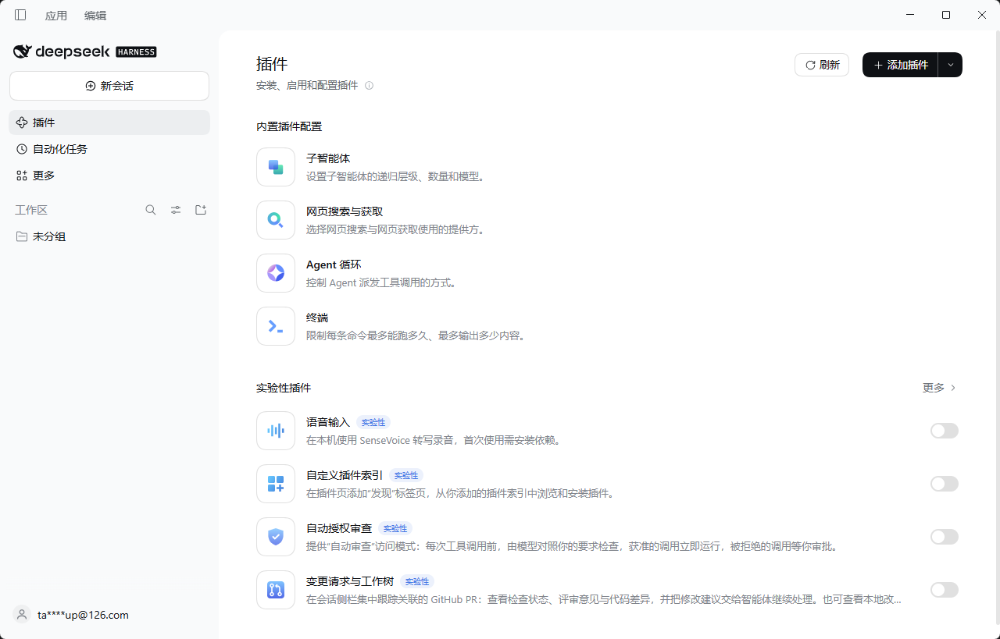

### 2.2 填写插件包名

在添加插件对话框中输入：

```text
cannbot-dsh@1.0.0-alpha.4
```

示例选择 **中国大陆镜像源** 作为安装源。确认无误后，单击 **安装**。

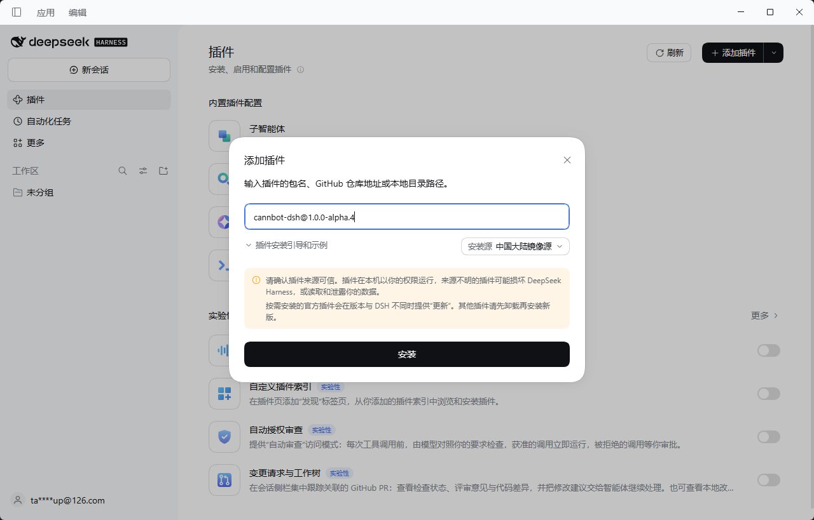

> 插件会在本机以当前用户权限运行。请只安装来源可信的插件，避免未知插件读取数据或影响本地环境。

### 2.3 等待安装完成

安装过程中可以展开 **查看安装详情** 了解进度；首次安装或网络较慢时，请耐心等待。

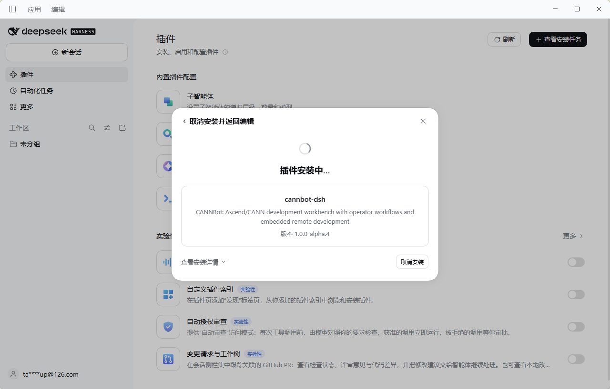

页面显示 **已安装** 后，单击 **立即启用**。

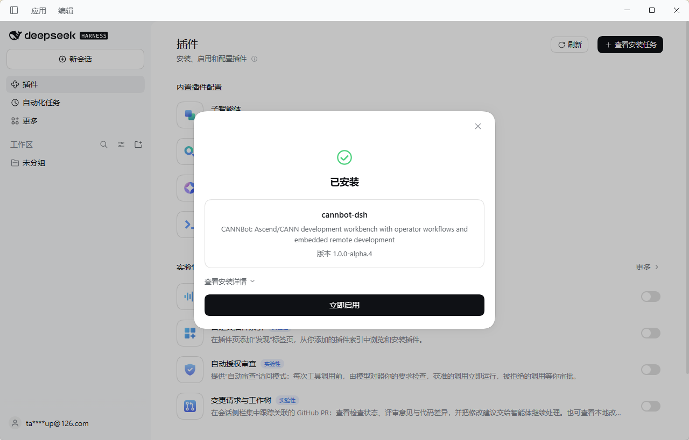

启用后，界面会切换为 CANNBot 工作台，左侧出现 **服务器** 等入口。

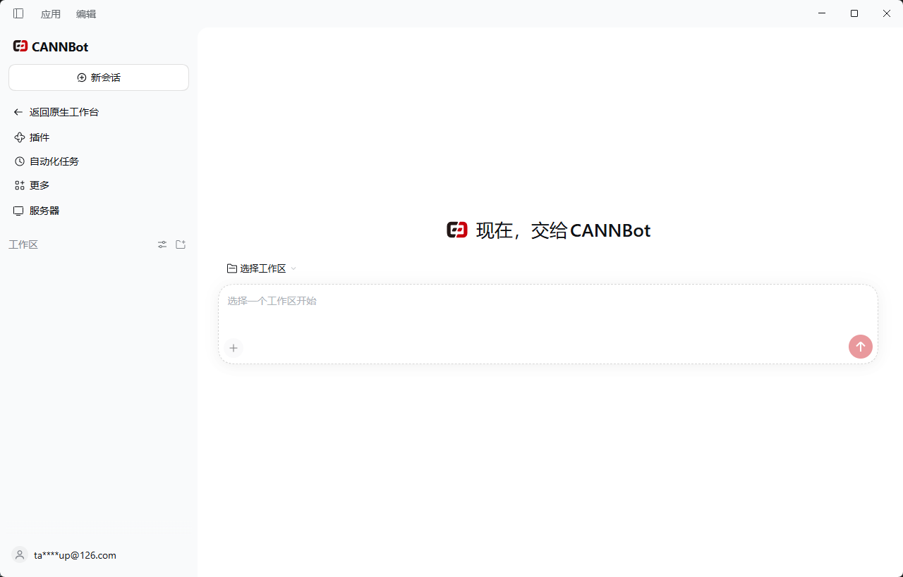

## 3. 添加并连接远程服务器

### 3.1 新增 SSH 服务器

1. 在左侧选择 **服务器**。
2. 单击页面右上角的 **＋**。
3. 在 **新增 SSH 服务器** 对话框中选择 **SSH 命令／已有配置**。

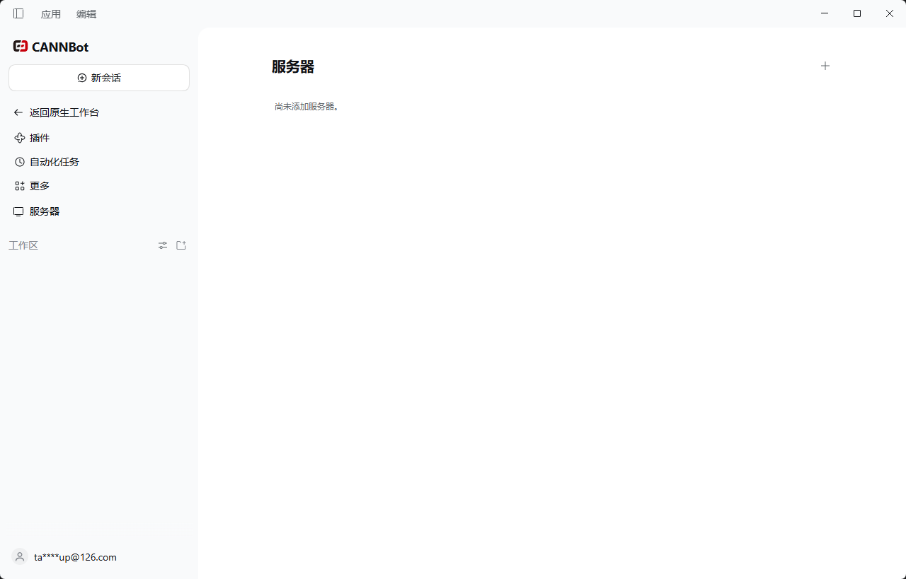

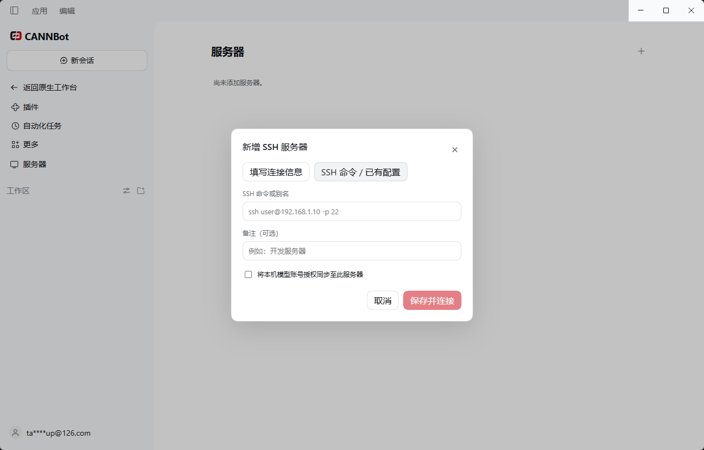

### 3.2 填写连接信息

按以下格式填写 SSH 命令或已有配置别名：

```bash
ssh <用户名>@<服务器地址> -p <端口>
```

同时可以填写便于识别的备注，例如 `cannbot-dsh`。

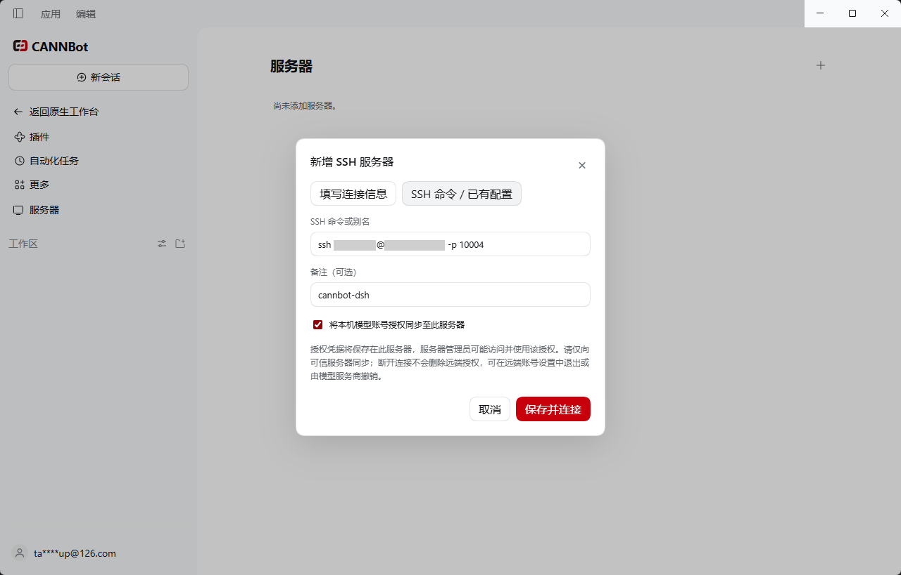

**可选：同步本机模型账号授权**

示例勾选了 **将本机模型账号授权同步至此服务器**。该功能便于远程工作流调用模型，但需要注意：

- 授权凭据会保存在所连接的服务器上，服务器管理员可能访问并使用该授权。
- 只应向可信服务器同步授权。
- 断开服务器连接不会自动删除远端授权；如不再使用，应在远端账号设置中退出，或到模型服务商处撤销授权。

确认信息后，单击 **保存并连接**。

### 3.3 等待远端环境准备

CANNBot 会自动执行以下检查和准备：

- 检查 SSH 连接。
- 检查远端 `dsh` 与 CANNBot 插件版本。
- 检查并准备 Node.js、`dsh`、`pnpm` 和 `cannbot-dsh`。
- 准备远程工作台环境。
- 同步当前 CANNBot 构建及工作流依赖。

如果远端版本不匹配，系统可能自动重新安装。首次准备可能需要数分钟。

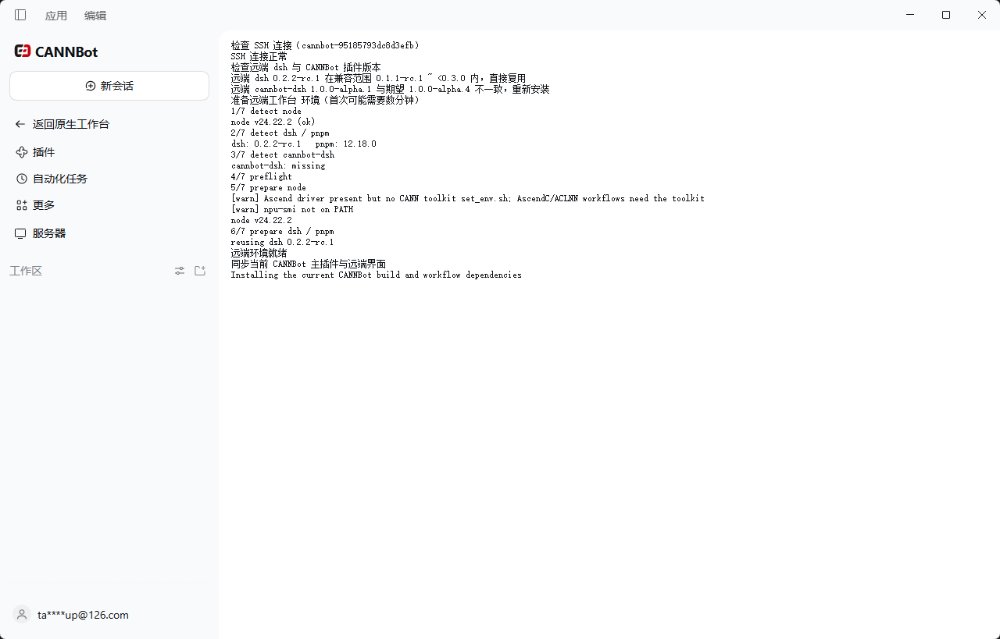

## 4. 创建远程工作区

### 4.1 进入创建工作区页面

回到 CANNBot 首页，在输入框上方单击 **选择工作区**，然后选择 **创建工作区**。

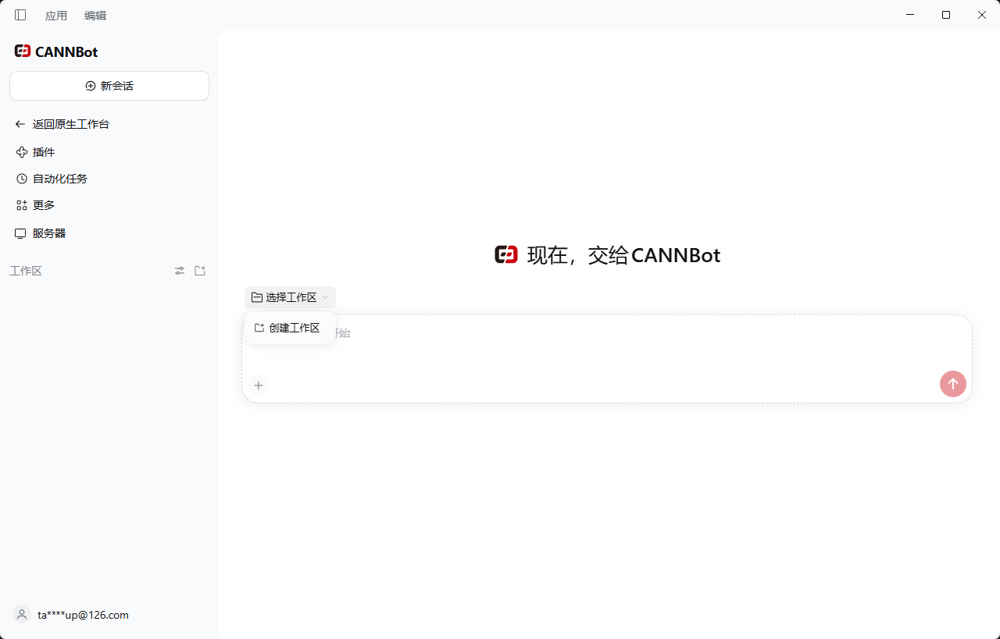

### 4.2 填写工作区配置

参考下表填写：

| 配置项 | 填写内容 |
| --- | --- |
| 工作流 | `ops-direct-invoke-flash`：快速生成并验证 Ascend C 算子 |
| 服务器 | 选择上一步已连接的服务器，例如 `cannbot-dsh` |
| 父目录 | 远程服务器上的可写目录，例如 `/home/<用户名>` |
| 工作区名 | `cannbot-dsh-test`，也可自定义 |

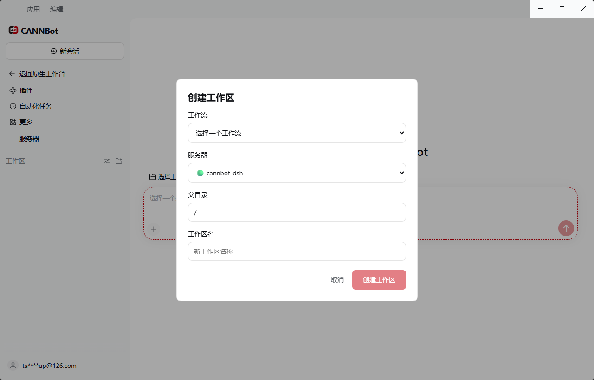

示例的完整配置如下：

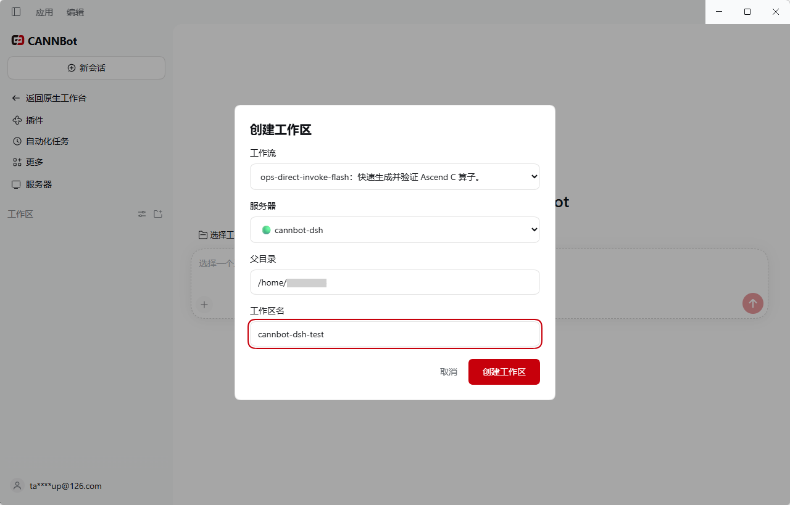

单击 **创建工作区**，等待系统加载远程工作台、插件、会话和工作流配置。

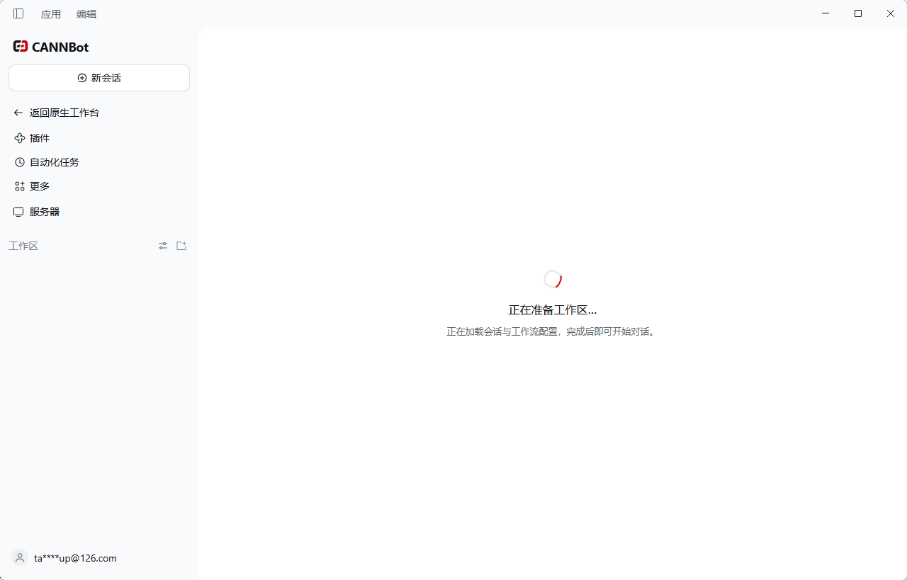

### 4.3 设置工作流权限

首次进入工作流时，页面会提示是否授予完全权限。

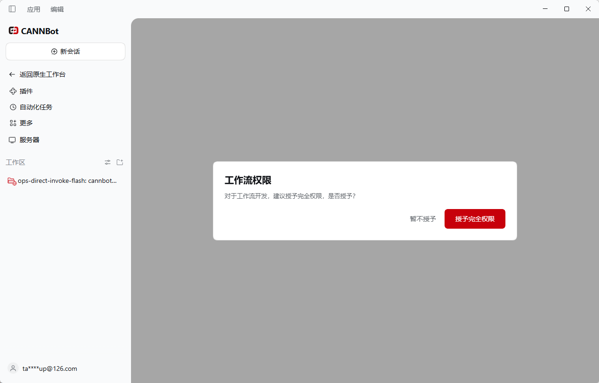

- 在隔离、可信的试用环境中，可按需选择 **授予完全权限**，让工作流自动执行开发、编译和测试操作。
- 在权限敏感的环境中，可选择 **暂不授予**，并在后续操作中逐项确认。
- 授权前应确认远程目录、执行命令和代码变更范围符合预期。

## 5. 使用自然语言开发并验证算子

### 5.1 提交开发需求

确认当前工作区为 `cannbot-dsh-test`，工作流为 `ops-direct-invoke-flash`，然后输入：

```text
帮我快速开发一个 abs 算子，数据类型支持 float16，并完成编译和真机验证。
```

单击右下角的发送按钮提交任务。

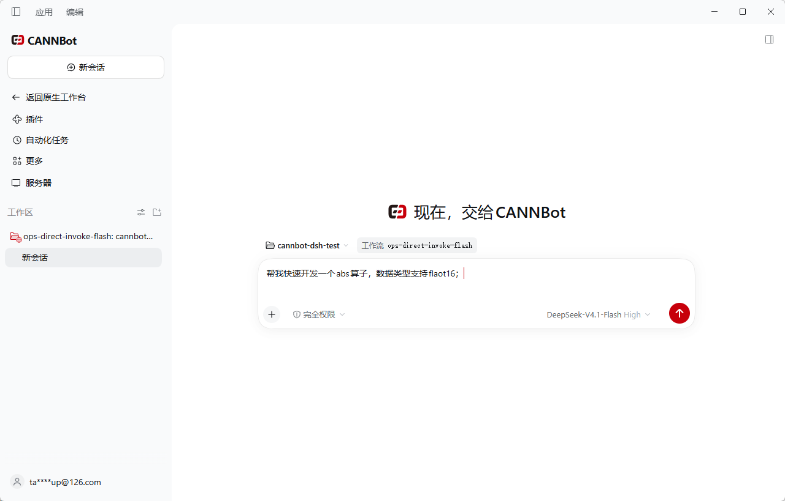

> 示例使用 `DeepSeek-V4.1-Flash High` 模型。实际可选模型以当前账号和界面为准。

### 5.2 查看执行过程

提交后，可以在 **对话** 和 **轨迹** 中查看工作流执行情况，包括：

- 检查工作区和算子目录。
- 检测 NPU SoC 及运行环境。
- 生成或编辑算子实现与构建文件。
- 重新编译并运行测试。
- 定位编译、链接或运行问题并继续修复。

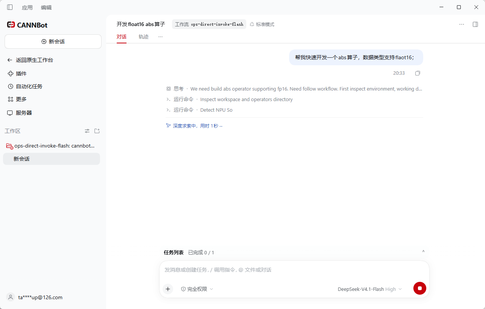

底部的 **任务列表** 会显示任务完成进度；执行时间取决于环境、算子复杂度和问题修复次数。需要中断时，可单击输入框右下角的停止按钮。

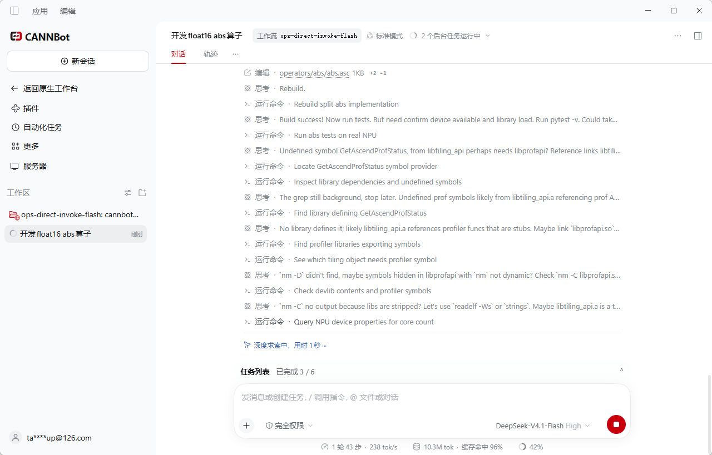

### 5.3 检查结果

本示例最终显示：

- `abs` 算子开发完成。
- `float16` 在 Ascend950DT（`dav-3510`）上通过真机验证。
- 本示例用时约 10 分 33 秒，任务列表完成 `6/6`。
- 结果中列出了实现说明、关键文件和环境适配说明。

> 以上设备、耗时和任务数量仅为本次示例的结果，不构成对其他环境或任务的保证。

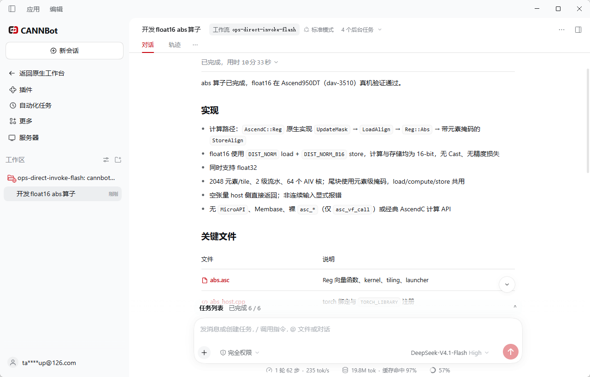

本示例的关键文件包括：

| 文件 | 作用 |
| --- | --- |
| `operators/abs/abs.asc` | Reg 向量函数、kernel、tiling 和 launcher |
| `operators/abs/abs_host.cpp` | PyTorch 绑定及 `TORCH_LIBRARY` 注册 |
| `operators/abs/CMakeLists.txt` | 算子构建配置 |
| `operators/abs/README.md` | 算子说明文档 |
| `troubleshooting.md` | 环境适配与问题排查记录 |

示例共编辑 9 个文件。建议展开文件变更列表，逐一检查代码和构建配置，不要只依据“已完成”提示判断结果。

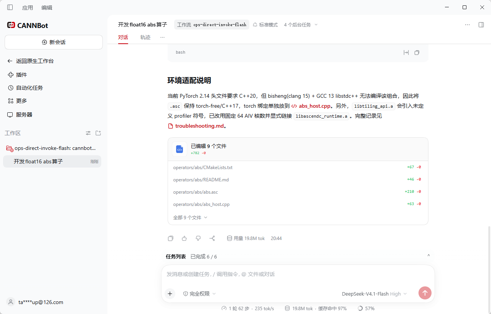

## 6. 安全与使用建议

1. **仅安装可信插件**：插件具有本机执行能力，未知来源插件可能带来数据和安全风险。
2. **谨慎同步模型授权**：只同步到可信服务器；断开连接不等于撤销远端授权。
3. **控制完全权限范围**：优先使用隔离测试环境和独立测试目录。
4. **检查自动执行的命令与代码**：尤其是编译脚本、链接参数、文件写入和远程目录变更。
5. **不要将示例结果直接视为生产交付**：仍需人工审查、边界测试、精度验证和性能评估。
