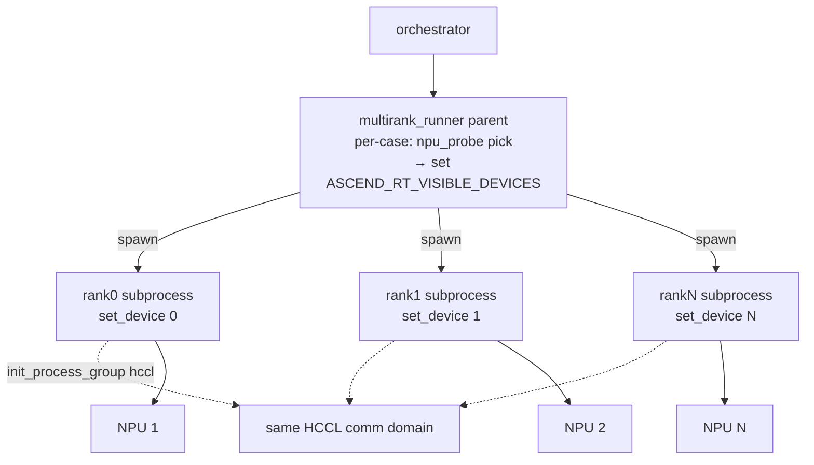
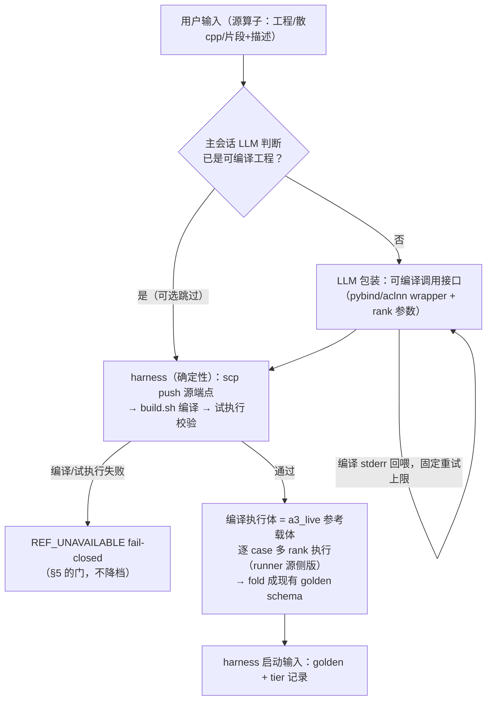

# Multirank Extension Design — A3→A5 多卡融合算子迁移

> Plugin `ascendc-port-orchestrator`。本文档描述 **multirank 扩展**：`port_a3_to_a5`
> 迁移流水线对**通信、通算融合**算子（跨 rank 集合通信与计算融进同一个 AscendC
> kernel 的多卡算子）的多卡 harness 能力。Companion to
> [`../ARCHITECTURE.md`](../ARCHITECTURE.md) §2.3 / §6.3 / §13.1。
>
> **Doc-first（ARCHITECTURE.md §11）**：本文档是随实现演进绑定规格，文档与代码同提交演进。
> 模块路径相对 `engine/src/scripts/`。

## 1. Context & Goal

单卡迁移流水线（`port_a3_to_a5`）没有 torchrun / HCCL / world_size 概念，无法生成、
更无法验证 A3/A2 侧已把计算与跨 rank 集合通信融进同一 kernel 的算子（cube 计算在
AIC、跨 rank 通信在 AIV 的融合 kernel）。

**Goal**：为 port 编排器增加**多卡 harness 能力**。目标仍是把源侧算子正确迁移到 A5；
对融合形态的算子，引擎额外提供多 rank 真值、构建链与逐 case 多 rank 验证。worker
（LLM）在既定结构与 A5 平台约束下完成目标 kernel。生成保持 **kw-centric** ——
spawn 的 agent 类型与 FSM 状态与其它模式完全一致（kw→`await_worker`，
pp→`await_probe`，ko→`await_optimizer`）；差异只在 brief 内容与 O5 runner。
知识复用并增补原 port 插件 KB（arch35 平台约束、tiling、精度与性能方法论）。

**架构约束**：
- **不是独立的第三个 mode**。multirank workspace 落在 `port_a3_to_a5` mode +
  durable state 的 `multirank: true` 标志上；CLI 入口 `--multirank
  --port-a3-ops <ops-nn-dir> --npubench-task <task.py>`（launcher
  `--mode port-a3-ops --multirank`）：源算子目录必选（与单卡同款约束，staging 至
  `.source_arch22/`），task 静态转换为内部 spec；与 `--backward` 互斥。
- **全部能力收敛在拓展插件** `engine/src/scripts/orchestrator/plugins/multirank/`。
  原插件（core + port_a3/backward）只做最小委托：`PortA3Plugin` 上的
  `is_multirank_workspace()` 判定与 `verify_files` / `forbidden_patterns` /
  `extra_finalize_checks` / `finalize_perf_capture` 的条件委托。
- 单卡行为零变化；核心模块不含 mode/plugin 字面量（`architecture_lint`：
  `CORE_MODE_LEAK` / `PLUGIN_NAME_BRANCH` 守住）。

## 2. Design Principles

### 2.1 能力栈模型（harness 零发明）

harness 提供能力 + 验证 + KB；融合结构与 kernel 实现由 LLM 决定（融合优化形态太多样，
无法用静态骨架穷举）。框架选型由算子设计文档自行决策，harness 不提供框架特定支持
（至多 C 类 KB 参考）。

### 2.2 四类边界

| 类 | 内容 | 归属 |
|---|---|---|
| **A — 固定样板** | CANN 强制的最小集，由 kw_brief 声明、scaffold 落位 | worker（经 scaffold 工具） |
| **B — KB 强制** | 三层同步（`multirank_communication.md`：核内 / 核间 / 跨 rank） | KB（brief 强制加载） |
| **C — KB 可选** | catlass 模板 / HCCL-resource 辅助 / 高层 HCCL API | KB |
| **D — 基础设施** | 多卡 runner / 构建链 / 卡分配 / 安全门 | 引擎（拓展插件内） |

A 类固定集恰好是：`GetHcclContext<HCCL_GROUP_ID_0>()` 入口（判空）、TilingData 前两
字段 `Mc2InitTiling`/`Mc2CcTiling`、host 端 `NnopbaseSetHcclServerType(MTE)`。
除此之外（`.MC2().HcclGroup()`、`Mc2CcTilingConfig`、kernel-type 配比、哪个核 init
HCCL context）都是 KB/pattern 指引，绝不是 brief 硬性规则。

### 2.3 篡改面消除（反作弊是结构性的）

- `multirank_verify.py` 常驻拓展插件（`plugins/multirank/reference_provider/`）并
  **就地执行**——绝不 stage 进 workspace。staged 副本是 worker 可篡改面；就地执行从
  构造上移除该向量，并把每个 op 钉在 harness verifier 版本上。worker 的适配层是
  `model_new_ascendc.py`。
- golden 只存 identity + `full_inputs` + `canonical_outputs`；每个 rank 的输入/输出在
  发射时由 spec 的 `shard`/`expected` **派生**——rank 份额从不落盘，无从漂移。
- 卡分配 harness 持有（`npu_probe` 发射前探测、发射后确认）；`spec.py` 对 worker 只读。
- 通信路径：**Path 1**（host 侧高层 HCCL 集合通信）不支持——与 MTE server 设置冲突；
  **Path 2**（复用 HCCL 资源的 window RDMA，MTE server + `CrossRankSync*` 软同步）为
  scaffold 默认；**Path 3**（shmem 通信域）是 worker 合法选项。同步原语在 KB
  （`multirank_communication.md`），永不 vendor。

### 2.4 spec 控制的 campaign

- **world_size 与 case 解耦**：spec 顶层 `world_sizes` 为全局默认，case 可选
  `world_size`（正整数或非空列表）覆盖。golden 展开：case-major → ws 升序 →
  profile 最内；每条记录自描述 `{idx, case, world_size, profile, name}`
  （`name` = `case{i}@ws{ws}[{p}]`；`idx` 是机器 reconcile 键）。无 CLI 覆盖。
- **逐 case 隔离**：每个展开 case 一个 `golden/<case>.pt`（由 `golden/manifest.json`
  索引、spec 哈希绑定）。runner **每 case 发射一个**多 rank 进程组
  （`--ref golden/<case>.pt --filter-case`）：独立 HCCL init、独立 golden 加载、
  独立卡探测、rank 日志在 `workspace/.run/<case>/`（dot 前缀，不进归档）。
- **`input_profiles` 是数值域覆盖维度**：矩阵 = (case × ws) × profiles；确定性
  `randn` 基底（seed `seed+idx`）经 harness 固定枚举变换——`randn` / `zeros`
  （~40% 精确 0）/ `large`（×100）/ `small`（×1e-3）/ `boundary`（{0,±1,±0.5}）；
  未知名字 fail validation。模板预设 `["randn"]`；压力 profile 按算子选配；perf
  不扫 profiles。
- **入口机制**：入口 skill 引导预交接；主会话按用户描述撰写 task + sidecar
  ——一种新的 op-gen 输入模态（用户描述输入），区别于 A（源算子目录）与 B（可微分
  正向 spec）。

## 3. Architecture

### 3.1 多 rank 进程架构



（单卡模式的单进程架构不变。上图为 multirank：每 case 一个进程组。）

### 3.2 设备绑定（multirank_runner + npu_probe，逐 case）

卡组由**实时空闲探测逐 case 自动分配**（`multirank_runner.run_all_groups` 内）：
按 world_size 升序（同 ws 内 manifest 序）；每次发射前 probe+pick，发射后确认卡仍
进程干净——campaign 中途的外部占用至多污染实际重叠的 case。`--lane` 列表对
multirank 无效（CLI 警告并丢弃）。探测源可替换：`.ascendc_env` 的
`{TARGET}_NPU_INFO_CMD` > `NPU_INFO_CMD` > 本地 `npu-smi info`。parent 取分配列表
（**可非连续**，如 `[1,2,4,8]`）设置 `ASCEND_RT_VISIBLE_DEVICES`；CANN 把掩码重映射
为本地索引 `0..N-1`；各 rank `torch.npu.set_device(local_rank)`。

### 3.3 插件与模块职责（拓展插件内，`engine/src/scripts/orchestrator/plugins/multirank/`）

| 模块 | 职责 |
|---|---|
| `__init__.py` | `MultiRankPlugin`——扩展全部能力面：`detect` 恒 False（workspace 判定归 `PortA3Plugin.is_multirank_workspace`）；`MULTIRANK_FORBIDDEN`；kw/pp/ko brief 覆盖；`extra_finalize_checks` 三门；`finalize_perf_capture`（多卡 A/B campaign）；`resolve_truth_source_tier`（真值分层）；`provision_reference` / `run_verification` 委托入口 |
| `multirank_phase_o25.py` | O2.5 真值提供：双档参考执行采集 golden（npubench：task `Model` 在 A5 多 rank 执行；a3_live：源端真实算子多 rank 采集）+ `declared_case_world_sizes` 单一来源；spec 哈希幂等缓存 |
| `multirank_runner.py` | O5 多卡 runner：每 case 一次发射（N 个 rank 子进程执行 harness 树 `multirank_verify.py`）→ fold → aggregate → verification.json；`--perf` 轮 |
| `multirank_emit.py` | verification.json 发射（runner + reconcile 共用）；`perf_only` 纪律只更新 `performance` |
| `multirank_o5_reconcile.py` | 覆盖感知 O5 reconcile + 持久 `.o5_verified.json` 标记（§8） |
| `multirank_rank_verdicts.py` + `multirank_finalize_check_rank_verdicts.py` | rank-verdict 块组装 + MULTIRANK_RANK_VERDICTS 门（§7.2） |
| `multirank_precision_eval_two_tier.py` | canonical judge：T1 对真值；T2 spec 声明制（`t2_competitor` → `PASS_T2`，未声明 → `N/A_ALL_T1`）；ALL-rank-PASS = PASS |
| `reference_provider/multirank_verify.py` | 逐 rank canonical verifier（harness 常驻，§2.3）：init HCCL → 跑 kernel → 判定 → rank summary；发射看门狗 + `--perf` + `--filter-case` |
| `op_template_gen/multirank_msopgen_scaffold.py` | 确定性 codegen：msopgen 通用工程 → 增量 multirank 补丁；拒绝覆写 |
| `op_template_gen/multirank_assets/` | `run.py` 统一入口 + `CLAUDE.md` 约定实体 |
| `patches/multirank_build.py` | cmake opc 三段构建（§6） |

`npu_probe.py` 留在引擎共享层（可替换卡探测，单卡 npubench 路径同用）。

**core 侧最小委托点**（唯一允许感知 multirank 的核心位置，全部经 durable-state
`multirank: true` 标志而非新 mode 字面量）：

| 位置 | 委托 |
|---|---|
| `orchestrator.run_single_op` | `_workspace_is_multirank` 旁路 reference binding / source-stage 预检 |
| `fsm_phase_o25_dispatch.provision_reference` | port_a3 分支首位 → `_provision_multirank` → 扩展插件 provision |
| `phase_o5.expected_truth_source` | 返回伞形 `"multirank"`（tier 细分由扩展插件解析） |
| `fsm_phase_finalize` | O5 runner 选择 / R2 skip / infra 分流 / perf 捕获 |
| `briefs.kw_brief` | multirank workspace → 扩展插件 kw brief（跳过 FA 模板） |
| `briefs._common.resolve_plugin_for_brief` | multirank workspace → 返回 `MultiRankPlugin`（pp/ko 覆盖生效） |
| `PortA3Plugin`（port_a3 插件内） | `is_multirank_workspace` + `verify_files`/`forbidden_patterns`/`extra_finalize_checks`/`finalize_perf_capture` 条件委托 |

## 4. Lifecycle

**预交接输入（FSM 之外）**：KernelBench 风格 task `.py` + 同 stem sidecar
（契约见 §5.0；CLI 入口经 `task_to_spec` 静态转换为内部 `spec.py`）。

| 阶段 | 归属 | multirank 差异 | 额外产出 |
|---|---|---|---|
| CLI dispatch | harness | `--multirank --port-a3-ops <dir> --npubench-task <task.py>`（task+sidecar 静态转换）；冲突检查；lane 列表警告丢弃 | — |
| `_cmd_multirank` | harness | 校验 ops-nn 源目录 + task；staging 源码（`.source_arch22/`）；task 静态转换为 spec；建 workspace；种子 `op_classification.json`（tags=`multirank_fusion`）+ `.opgen_state.json`（`opgen_mode=port_a3_to_a5` + `multirank:true` + `spec` 路径 + 单卡同款 staged-source 字段） | `workspace/<op>/spec.py` |
| O0 / O3 | harness | 标准 | — |
| O1.7 classify | model agent | 运行（不跳过）；预种子无 source hash → LLM 覆写 | — |
| O2 benchmark sync | harness | 事实跳过——真值来自 spec | — |
| **O2.5 reference** | 扩展插件（`multirank_phase_o25.provision_multirank_reference`） | 整体替换 provision（无 benchmark 自动生成重试）；真值层选择见 §5 | `golden/<case>.pt` + `golden/manifest.json` + `model.py` + 五个 canonical 工件；`multirank_verify.py` 不 stage（§2.3） |
| **O4 worker** | `aog-kernel-worker` | kw_brief 整体替换（§6）；A.5 先 scaffold；逐 case 多 rank 验证 | `prj-<op>/` 工程 + `model_new_ascendc.py` + `knowledge_update.md` |
| O4 probe | `aog-precision-probe` | 多 rank 复现；二分 = rank 全挂（计算）vs 子集挂（通信竞争） | probe_report.md + probe_result.json |
| O4 optimizer | `aog-kernel-optimizer` | ko_brief 替换（多卡变体） | — |
| **O5 re-measure** | harness → 扩展插件 runner | runner = `multirank_runner.run_all_groups`；覆盖感知 reconcile（§8）；truth_source=`multirank` | `verification.json` `multirank` rank-verdict 块 + `pass_b.status="N/A"`（被多 rank 验证吸收）+ `performance`（§9） |
| finalize | harness | multirank 三门（§7）；perf 经 `PortA3Plugin.finalize_perf_capture` 条件委托到扩展插件（§9） | 归档：`prj-<op>/` 整体晋升（§10） |

### 5.0 输入形态（用户面 task / 内部派生 spec）

用户面推荐输入 = KernelBench 风格 task `.py` + 同 stem sidecar（与单卡
npubench 同格式），多卡扩展仅三个可选声明位：sidecar case 级 `world_size`、
模块级 `NEEDS_EP_COMM = True`（参考需真实 HCCL 组，`forward` 收尾随
`comm` 关键字——含 `hcomm_info`/`rank`/`world_size`/`device`）、spec 级
`tolerance`（int8 量化参考的 atol/rtol 覆盖）。生成器签名
`get_init_inputs(rank=..., world_size=...)` /
`get_input_groups(rank=..., world_size=...)` 按关键注入（单卡位置形态不受
影响）。`task_to_spec` 静态转换器把它转换为内部 spec.py：引用式平移
（Model/生成器不重写）+ sidecar 数据直映 + 冻结 task/sidecar 字节进
`task_sha256`（golden 缓存键原料）。生成式 spec 的输入由 task 生成器产生
（引擎不做 randn/profiles materialize），golden 直接存 per-rank 份额
（verify 不再派生）；派生式 spec（`shard`/`expected` + full materialize）
继续受支持，a3_live 档目前仅派生式接线。

## 5. Truth Source：真值模型（双档）

multirank workspace 的 `expected_truth_source` 返回伞形 `"multirank"`；tier 由
`MultiRankPlugin.resolve_truth_source_tier` 解析（读 durable state 的
`multirank_truth_source`；tier 由 SPEC['truth'] 声明或 `--reference-source` 选择）。双档：

| Tier | 内容 | 执行方式 | 精度 | 性能 A/B |
|---|---|---|---|---|
| `a3_live` | 源侧（A3/A2）真实算子 | 源端点现场编译源算子 wrapper 工程（build.sh + wrapper.py，§2.1）→ 按 spec 声明的 world_size 组多 rank 执行 → 输出回收为 golden；spec 的 `expected` 仅作键/形状对账。CLI：`--reference-source a3_live` | ✅ | ✅ |
| `npubench` | spec 的 `expected` 即参考实现 | `expected` 在候选端点（A5）上经 `multirank_npu_bench_collect` 子进程采集器执行——与候选 kernel 同一多卡 launcher（每 case N 进程、npu_probe 分卡），参考与候选共享同一环境；**无需源端机器**。CLI：`--reference-source npubench` | ✅ | ✅（`--perf` A/B 以参考为基线） |

`npubench` 的信任模型与单卡 npubench 相同（参考实现由输入提供方准备并复核
语义）；`a3_live` 的真值独立于任何人的重新理解，是迁移验收的强标杆。

spec 即考卷：`cases`/`input_profiles` 定义 case 空间与数值域，golden 按
case × world_size × profile 展开；`shard`/`expected` 只承担键/形状对账契约，
值不比（真值在源算子执行里）。

**`expected` 的角色**：键/形状对账契约。它给出 canonical 输出的键与形状（每
rank 的份额由 `shard` 派生），golden 值来自源算子的多 rank 执行——`expected`
从不作为对账值使用，写法上只要求可加载与返回正确的键/形状。

**`multirank_phase_o25` 的 provision 链**：按 spec 声明的 case × world_size ×
profile 展开，产出按 spec 内容哈希幂等的 `golden/<case>.pt` 树；verify 时各 rank
子进程从全量 tensor 经 `shard` 重新派生自己的输入、与源算子执行回收的
canonical 输出按键/形状对账。这是对 A（A3 实测捕获）与 B（CPU/fp64 autograd）的 analogue——不需要
A3 参考环境。

**tier 声明的生产侧**：`SPEC['truth']` 字段是 tier 的**持久声明点**（与
`world_size` 同一 case-controlled 原则，spec 即考卷）。CLI `--reference-source`
（多卡下 `npubench`/`a3_live` 映射 `npubench`/`a3_live`）在 spec 未声明时
充当声明、与 spec 声明并存时必须一致——不一致 fail-closed，绝不静默覆盖。
`_cmd_multirank` 启动时解析生效档位落 durable state
`multirank_truth_source`，下游（`resolve_truth_source_tier`、provision、门）统一读
state（`read_truth_tier` 单一读取方）、不重复 exec spec。换档即改 spec 字节，
golden 缓存键（spec 内容哈希）天然覆盖——无需额外 tier 混入。非法值在解析期即拒绝（值永不进入 state）。

**tier × 端点 fail-closed（`multirank_endpoint.py`）**：执行端点 =
角色（candidate=TARGET 块 / source=SOURCE 块）× `.ascendc_env` 代际块的
`<PREFIX>_EXEC` 四态（local/local-container/remote/remote-container）。启动期与
provision 期双重校验（provision 期先于幂等缓存）：`a3_live` 要求候选端点
配置完备且 SOURCE 代际块存在完备、wrapper 工程就位；否则响亮失败（启动 exit 2 /
provision `REF_UNAVAILABLE`），**绝不静默降级**。**执行全流程端点化**：候选端点
`EXEC=local` 走 `multirank_runner` 本机 Popen 发射；`remote/remote-container` 时
verify/perf campaign 同样远端执行——campaign 开头一次性 staging（canonical verifier +
launcher + 可执行面：spec/golden/model/prj `.install`+py_ext，md5 清单跳过），
逐 case 发射 `multirank_remote_launch.py`（远端每 rank 一进程一卡，同款 opp env
注入），rank 日志+rc 拉回后走**与 local 完全相同**的解析/合成 ERROR/聚合语义；
卡探测远端化（`remote_exec npu-smi` + 同款 `lane_pool` 解析，不足卡走 UNVERIFIED
逃生舱）；launcher 级失败 = 该 case 全 rank 合成 ERROR（被测量，绝不丢弃）。

**`a3_live` 采集（§5.1 流程）**：预交接 wrapper 工程（`workspace/<op>/source/`：
`build.sh` + `wrapper.py`（rank 可调入口 `run(rank_inputs, rank, world_size)`，
契约见 design guide §2.1；`wrapper_artifact_errors` 启动期 + provision 期双查，
含本地语法检查）。provision 编排（`multirank_phase_o25.py`）：staging 工程树 +
spec + driver（md5 跳过）→ 源端点 `build.sh` 编译 → 逐 case 经 `multirank_endpoint`
原语发射源侧执行——**每 rank 一进程一卡**（hccl 进组，与候选发射
同构）→ canonical 视图 = ws=1 退化路径执行 → 输出拉回 fold 进共享 golden schema。
语义锚：spec 的 `expected` 在 CPU 侧跑出键/形状基准，源侧输出的**键集合与形状
必须对齐**（值不比——源侧即真值）；键/形状不匹配 = wrapper 缺陷 →
`REF_UNAVAILABLE`。编译失败（stderr 回预交接修复循环）/工件缺失/卡不足全部
fail-closed。缓存命中额外校验 `manifest.truth_tier` 与当前声明一致（深度防御）。

**性能与留痕**：golden/manifest.json 与 verification.json["multirank"] 均记录
`truth_tier`（真值来自哪档），perf A/B 以源算子的同一执行作为基准侧（候选与
基准分隔离 HCCL 子组）。


### 5.1 NPU 参考采集设计

**端点无关编排（两档共用原则）**：参考采集的编排逻辑（跑什么、fold 成什么
schema、A/B 怎么对）对远近端是**同一份代码**；远近端只是 `multirank_endpoint`
原语的实现差异（local=Popen / remote=ssh），由 `.ascendc_env` 的 `EXEC` 四态配
置决定。约束：用户配置的机器必须是带 NPU 卡的目标。remote 原语未接线时大声报
错（与 `WIRED_TIERS` 同一 fail-closed 思路），不静默换路径。

**a3_live 流程（预交接包装 → 远端编译验证 → harness 启动输入）**：



与既有件的对应：拷贝/编译/试执行 = `a3_ref_provision` 三段式原样（固定产物名 +
fresh-capture）；「能成功编译执行」= §5 fail-closed 门（a3_live 要求参考工件
存在**且编译过**）的通过条件；源工程 = 预交接工件之一（与 `spec.py` 并列，自带
或 LLM 包装产出）。LLM 面纪律不破：主会话只碰包装文本，编译/执行/拉取全由
harness 确定性做。

四个定死的点：
1. **包装重试**：编译 stderr 回喂主会话修复，固定重试上限（照 kw build 内循环
   惯例），超限 fail-closed——不开放无限循环；
2. **语义锚**：编译通过 ≠ 语义对。真值语义锚在 `spec.py`（用户批准过）；包装
   执行体的试执行校验 = 输出键/形状/dtype 与 spec 声明一致 + 有限值检查；
   a3_live 档下 golden 由源侧实测产出，spec 的 `expected` 在该档仅作对账；
3. **多 rank 接口契约**：包装的 py 接口必须按 rank 可调（`rank`/`world_size`
   参数，同 `multirank_verify` 调 candidate 的方式）——写进 design guide，主会话
   照契约包装；
4. **编译依赖 fail-closed**：源侧容器工具链差异不预问环境，运行时报错归类
   infra → PAUSE_RESOURCE，与卡短缺同路径。

**staging 映射对（宿主↔容器，代际块通用）**：

```
A<n>_STAGE_HOST_DIR=<宿主目录>        # scp push 落点（宿主侧）
A<n>_STAGE_CONTAINER_DIR=<容器目录>   # 容器内可见路径（bind mount Destination）
```

| 规则 | 内容 |
|---|---|
| 翻译 = 确定性前缀替换 | `translate_to_container(path)`：`STAGE_HOST_DIR` 前缀 → `STAGE_CONTAINER_DIR` 前缀；不再有写死的 `/home/<user>/` 规则 |
| 缺省回落现状 | 未配置时回落 `A3_HOST_HOME` + `/home/npu_user` 约定——现有部署零变化 |
| 一致性校验（P129 泛化） | `remote-container` 态下启动期 `docker inspect` 验证配置映射对真是该容器的 bind mount——配错立刻 fail-closed，不 scp 推错目录后中途炸（P129 事故教训） |
| 仅 container 态需要 | `local`/`remote` 态无容器，映射对不参与 |

**sync 原语带宽设计（remote 传输，scp-only）**：输入/输出 `.pt` 可能很大而
ssh 带宽可能很小，传输按**内容跳过**：

- 机制 = scp + **md5 清单**：传输前本地对每个文件算 `(md5, size)`，与远端
  staging 区的 `.sync_manifest.json` 比对，只传不匹配项，传完原子更新清单。
  正确性无前提——md5 相同即字节相同，跳过无损（内部传输优化场景接受 md5
  碰撞风险）。
- 两侧依据不同：**输入侧**跳"内容没变"（确定性 materialize：spec 没变 →
  输入文件没变 → 重试/重 provision 零重传）；**输出侧**先有执行级跳过
  （provision 的 spec_hash 幂等缓存——spec 没变不重新执行，没有输出要拉），
  文件级 md5 跳过只服务 resume/重拉场景。
- 明确不做：rsync delta（本地/远端都未必装）与远端 materialize（两端 torch
  版本一致性保证不了，RNG 跨版本可能不同 → golden 不可比）。

源侧环境形态由此不再是要预问的事实：挂载关系是**配置事实**（用户按机器实际
挂载填），编译链差异运行时 fail-closed，映射错被 docker inspect 门拦住。

**源侧卡探测**：复用 `npu_probe` idle 检测（探测目标换源端点；
`NPU_INFO_CMD` 的 target-first 解析已支持 `A<n>_NPU_INFO_CMD`），逐 case 选 N
张空闲卡；不够卡 → 现有 UNVERIFIED/PAUSE_RESOURCE 逃生舱，零新机制。

## 6. Worker Path（O4）：Scaffold → Author → Build → Verify

1. **Scaffold（A.5）**：`multirank_msopgen_scaffold.py`，`prj-<op>/` 不存在时执行
   一次（msopgen 通用工程 + 增量 multirank 补丁；拒绝覆写）。注入
   `--cce-auto-sync=off`。
2. **Author（B）**：`prj-<op>/op_kernel/<op>.{h,cpp}` + 根 `model_new_ascendc.py`。
   A 类固定集强制（§2.2）；融合结构自由。canonical 入口 `model_new_ascendc.py` +
   `model.py`（OL-160——并行的 `model_new_multirank.py` 被禁止；`model.py` 是参考，
   排除在 delegation 扫描外）。
3. **Build**：`patches/multirank_build.py`——cmake opc 三段：configure
   （opbuild→autogen→rename）→ wrapper 签名回填 → op_host 三库 + kernel 二进制 +
   py_ext。算子名取工程目录名。
4. **Verify（C）**：经 `multirank_runner` 多 rank（`run.py verify`）；逐 case，
   ALL-rank PASS = PASS。单进程自验被禁止（HCCL-null 假 PASS）。
5. **Knowledge（D）**：`knowledge_update.md`——融合方法 + 陷阱。

brief 差异：kw_brief 整体替换（强制 `multirank_communication.md` +
`sync_fundamentals.md` 加载、scaffold 阶段、NEST 布局；作者约束：通信内联 /
禁 `using namespace AscendC` / spec 只读）；pp/ko brief 替换为多 rank 变体
（`run.py build` / `run.py verify`，禁 `deploy_to_a5.sh`）。

## 7. 反作弊门

### 7.1 MULTIRANK_FORBIDDEN（委托扫描）

禁止 host 侧 HCCL 委托。扫描 `model_new_ascendc.py` + `op_host/**` + `op_kernel/**`：
`torch.distributed.*` / `hcom.*` / `aclnn*Hcom*` / `torch_npu.npu_*collective*`
（7 类模式）。通信必须写进融合 kernel 内部；把「通信」退化成 host 侧集合通信等于
把最难的部分委托给 HCCL，直接拒绝。

### 7.2 MULTIRANK_RANK_VERDICTS（6 不变量）

`verification.json["multirank"]`（`world_sizes` / `cases` / `rank_verdicts` /
UNVERIFIED 双通道）必须满足：

1. `multirank` 块存在（否则 multirank_verify.py 未发射——route 回 worker）；
2. 每个声明的 world_size 是 ≥1 整数；
3. 每个 ran ws 恰有 ws 条分类 PASS/FAIL 的 rank 条目（逐 case 发射折叠回 group
   形状）；卡短缺 ws 可代之以 probe 证据背书的 UNVERIFIED 占位；
4. verdict⟺claim 双向一致——全 PASS 模板盖 partial 计数（或全量 claim 下出现 FAIL
   rank）逻辑上不可能，拒绝；
5. UNVERIFIED 记录（整组 `unverified` 或逐 case `unverified_cases`）仅在携带客观
   probe 证据（`status`/`reason`/`detail`/`probe`）时被接受——worker 自报“没跑”
   不得绕过验证；
6. 覆盖划分：`multirank.cases` 声明 campaign 时，folded ∪ UNVERIFIED 按 ws 恰好
   划分声明的 cases——不静默丢、不重复计、不跨通道双报。

模式无关门（universal entrypoints、provenance）照常适用。

### 7.3 MULTIRANK_NAMESPACE_VIOLATION

`op_kernel/` / `model_new_ascendc.py` 内禁 `using namespace AscendC`——须显式限定
`AscendC::`。

## 8. UNVERIFIED 逃生舱（卡短缺覆盖缺口）

probe 无法分配到卡的 case 是 **UNVERIFIED 而非失败**。通道（runner → O5 → 暂停 →
用户决策 → 门）：

1. **Runner 记录、绝不丢弃**：卡短缺 case——只要已有 ≥1 case 跑过——记为带 probe
   证据的 UNVERIFIED 且 campaign 继续；仅当什么都还没跑时短缺保持 runner_error
   （O5 infra 重试/暂停接管）。整组未验 ws → 整组 `multirank.unverified` 占位；
   部分跑过的 ws 把 ran cases 折进 `rank_verdicts[ws]`，缺失记
   `multirank.unverified_cases`。
2. **O5 转发并暂停**：精度 VERIFIED 但 unverified 非空 → 暂停
   （`await_user_decision`，附覆盖清单：哪些 ws 已验、哪些未验、为何）。
3. **覆盖感知 reconcile**（`multirank_o5_reconcile`）：claim C
   （`multirank.rank_verdicts`）vs 实测 M——M∩C 不一致 = 真 MISMATCH（唯一 spawn
   worker 的路径）；M⊂C 且交集一致 = 短缺 → VERIFIED + 缺口转发；M⊃C 全干净 =
   AUTO-VERIFIED（claim 就地升级）；M⊃C 有 FAIL = MISMATCH（requirement 类分析归
   worker）。干净 harness 的 VERIFIED 另写持久 `.o5_verified.json` 标记（工件摘要 +
   golden spec_hash + unverified 集），重入 finalize 跳过复测、不重掷卡运骰子。
4. **Perf 轮同理**（§9）：infra 分配失败或未验组 → `status == "PAUSE_RESOURCE"` →
   同一暂停（operator 已接受的缺口被尊重、不重复暂停）。
5. **用户决策**（`user_decision.md`）：等卡重测，或持 **ACCEPT-UNVERIFIED** 令牌
   接受降级 campaign——编排器盖 `.coverage_accept.json`（记录接受的 world_sizes）；
   重入 finalize 对**同一**缺口不再暂停（**新的**未验 ws 仍会暂停）。
6. **门只收证据**（§7.2 不变量 5–6）。

反作弊：UNVERIFIED 记录由 probe 背书、harness 持有——worker 无法伪造「卡忙」跳过会
挂的 case；暂停绝不 spawn worker——worker 改 kernel，释放不了被占的卡。

## 9. Performance（插件范式）

multirank perf 遵循插件既有 perf 范式——一个工件、一条溯源链、一个报告面：

- **声明与测量**：spec 可选 `perf_baseline`（非融合参考）声明可测性——未声明 →
  `performance` 诚实 `N/A`（附原因）。声明后由 `finalize_perf_capture` 钩子（经
  `PortA3Plugin` 条件委托到扩展插件）驱动 `multirank_runner --perf`：多 rank 联合
  测量，逐 case 在自动分配卡上做 candidate-vs-baseline A/B。卡短缺经中性
  `PAUSE_RESOURCE` 哨兵暂停（§8 步 4）；coverage-accept 标记被尊重。
- **聚合**：两级——case 内逐 rank 取均值（对称工作量；跨 rank std = 负载均衡信号）；
  跨 case 每案以比值中位数投一票。绝对时间中位数仅作证据字段。
- **落地**：写 `verification.json` 的 `performance` 块，`independent_re_measure`
  （irm）由 `perf_irm_provenance.py` 盖戳——`ran=true` 必须带 orchestrator
  `source` 戳（finalize provenance 门强制）；multirank 多 rank 复测本身就是编排器
  侧独立测量。measured-FAIL 的 op 仍跑 perf 轮——PARTIAL_PERSIST 是合法终态归档类，
  其 ratio 是客户的选型证据。perf 发射绝不改写精度产物：`perf_only` 只更新
  `performance`，`precision` / `multirank` / `determinism` 不动。
- **刻意不引入**（与上游 harness 的分歧）：无 per-op `perf_report.md`、无可信执行
  收据（`runtime_perf_*` 模块不迁移）。反欺诈立场 = irm source 戳 + §7 门链。
- **报告**：人类可读性能报告走项目级 REPORT.md 表格注入链（`gen_report_tables.py`
  的 `BEGIN-GEN` 标记），与其它模式一致。
- **tier 约束（随 §5 三层接线落地）**：性能 A/B 仅允许 NPU tier（1/2）；CPU 仿真
  tier（3）仅精度——其性能声明应被门强制 N/A。

## 10. Archive

NEST 布局**整体晋升**：`prj-<op>/` 原样归档（dot 目录 / `.opgen_state.json` /
`__pycache__` / `*.bak` / `*.pyc` 过滤；`py_ext/_C*.so` 构建产物随行——客户端重建
覆盖）。无逐文件特殊映射。

## 11. 验证策略

1. **Unit**：npu_probe pick/confirm；spec 契约校验；MULTIRANK_FORBIDDEN 抓 host 侧
   `torch.distributed.all_reduce` fixture；O2.5 golden 正确性；spec-hash 缓存幂等；
   rank-verdict 门全 6 不变量（含 UNVERIFIED 证据 + 覆盖划分）；`perf_only` 不动
   精度；irm 盖戳；`PortA3Plugin` 委托（单卡默认保持 / multirank 委托生效）。
2. **Integration**：融合算子在声明的 world_size 组上全绿（ALL-rank PASS）；干净
   整 nest 归档；UNVERIFIED 暂停 → ACCEPT-UNVERIFIED → 重入 finalize 不循环。
3. **Regression**：port_a3 单卡 / backward 不受影响；finalize/gate 套件保持绿。

## 12. Known Gaps

1. **无自动化的核内同步审查。**`--cce-auto-sync=off` 下核内同步由 worker 手写；
   兜底是 KB 强制加载，不是 checker。
2. **`pass_b_required` 语义瑕疵（LOW）。**multirank workspace 继承基类默认 `True`，
   但 O5 路由到 `multirank_runner`、pass_b 路径永不执行，以 schema 合法的
   `pass_b.status="N/A"`（附原因）编码。
3. **真值双档（§5）**——预交接 wrapper 工程是源端真实算子接入
   harness 的唯一通道；源算子自动抽取 spec 是后续方向。
