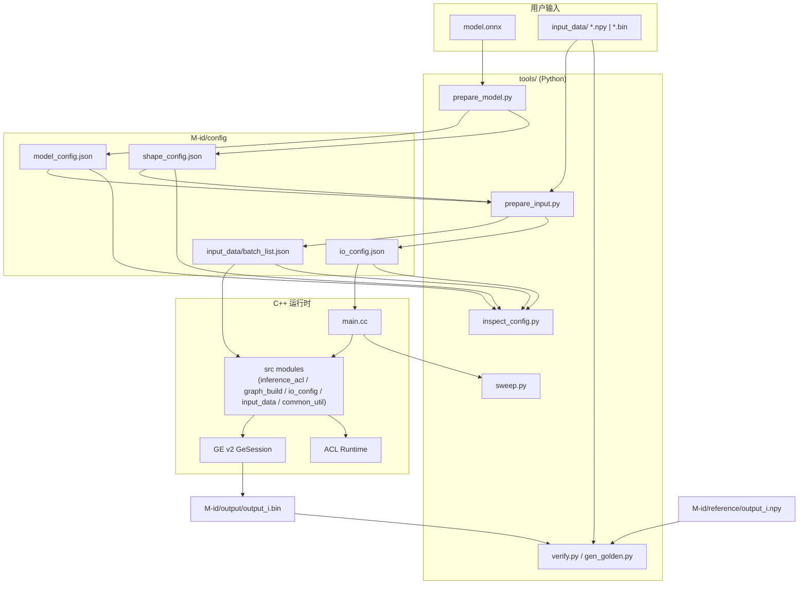
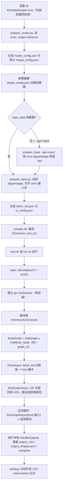
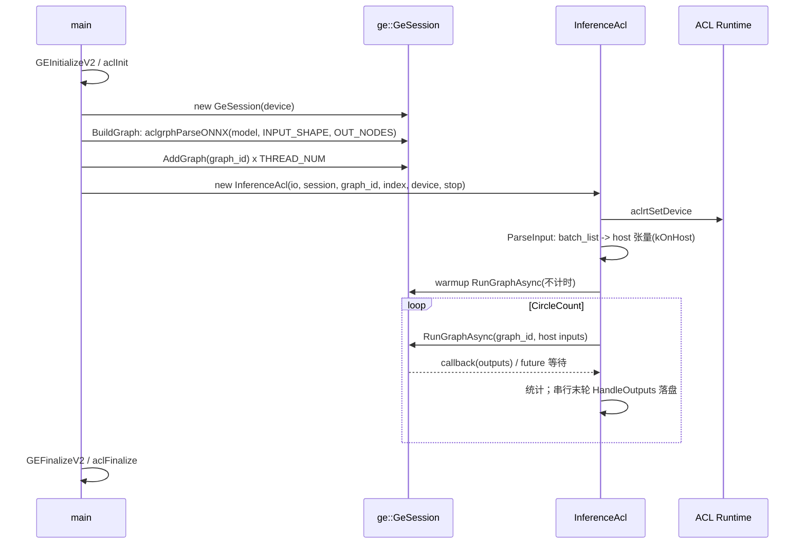

# GE_SESSION_DEMO

基于 GE Session（v2 `GeSession` + `RunGraphAsync`）的在线推理框架。输入为 `model.onnx` 与一份请求数据，框架自动分析模型、规范化输入、
生成配置并执行推理；模型适配完全由配置文件驱动，C++ 代码不含任何模型分支。

- 模型无关：新增模型只改数据与配置，不改代码。
- 配置驱动：`model_config.json` / `shape_config.json` / `io_config.json` / `batch_list.json`。
- 全流程工具：模型分析、输入规范化、配置校验、精度验证、并发限核扫描、profiling。

---

## 1. 架构总览



---

## 2. 端到端流程



上图中 `B`–`F1` 可整体由 `prepare.sh` 一键完成（见 §4 快速开始、§8 工具链）；无输入数据时加
`--gen-input`，由 `prepare_input.py` 按 onnx 的 dtype/shape 自动构造输入；非 batch 动态维需
`GEN_INPUT_SHAPE` / `--input-shape` 显式给出。

### 运行时调用时序



---

## 3. 目录结构

```
demo/
├── compile.sh                     编译 -> ./GEsession_test_acl
├── test.sh                        运行入口（env 驱动，分区注释）
├── run.sh                         便捷入口（长选项，调用 test.sh）
├── prepare.sh                     模型准备入口（一键 prepare_model + prepare_input）
├── GEsession_test_acl             编译产物
├── src/
│   ├── main.cc                    GEInitializeV2/ACL、GeSession、同 graph_id 重复 AddGraph、线程编排
│   ├── common_util.h/.cc          环境变量、JSON、shape 等公共工具
│   ├── io_config.h/.cc            InputCfg/OutputCfg/IoConfig 与加载、dtype 映射
│   ├── input_data.h/.cc           InputDataBase / InputData<T>
│   ├── graph_build.h/.cc          BuildGraph：parse onnx/tf + hint 选项
│   └── inference_acl.h/.cc        执行器：ParseInput(host) + RunGraphAsync 循环 + 串行末轮落盘
├── tools/
│   ├── common.py                  路径、dtype、onnx、JSON 公共库
│   ├── prepare_model.py           onnx -> model_config.json + shape_config.json
│   ├── prepare_input.py           输入规范化 -> batch_list.json + io_config.json
│   ├── inspect_config.py          配置校验报告
│   ├── gen_golden.py              CPU onnxruntime 生成标杆
│   ├── verify.py                  精度验证（golden 来源 + 逐输出 gate）
│   ├── check_provenance.py        模型/输入/标杆/配置同口径指纹
│   └── sweep.py                   限核/并发自动扫描
├── doc/                           README_EN（英文说明）
└── models/                        模型工作区根目录
    └── M<id>/                     单模型工作区
        ├── M<id>_env.sh           该模型专用环境（test.sh 每次自动 source）
        ├── model/model.onnx       用户提供
        ├── input_data/            输入与 batch_list.json
        ├── config/                model_config/shape_config/io_config
        ├── output/                输出与验证报告
        ├── reference/             精度标杆
        ├── report/                inspect 报告
        ├── sweep/                 扫描日志与报告
        └── .cache/                运行时临时区
```

---

## 4. 快速开始

以下为从零接入一个新模型的最小步骤与命令速览（`test.sh` 与 `run.sh` 两种入口等价，后者为长选项封装）。

```bash
cd demo

ID=<id>            # 替换为你的模型编号，如 001

# 1. 放置模型（必需）与输入（可选）
#    models/M$ID/model/model.onnx                  必需；外部权重须与 onnx 同目录
#    models/M$ID/input_data/<onnx输入名>.npy        可选；无输入时用 --gen-input 自动构造

# 2. 一键准备：分析模型 + 生成配置 + 规范化输入
bash prepare.sh $ID              # 无输入数据时：bash prepare.sh $ID --gen-input

# 3. 编译（首次或源码变更时）
bash compile.sh

# 4. 运行
bash run.sh $ID                  # 等价 MODEL_ID=$ID bash test.sh
```

第 2–4 步也可手动拆分，便于精细控制（`prepare.sh` 即对它们的封装）：

```bash
python3 tools/prepare_model.py $ID               # 生成 config/model_config.json + shape_config.json
vi models/M$ID/config/shape_config.json          # 按需改动静态策略（见 §6）
python3 tools/prepare_input.py $ID [--gen-input] # 生成 input_data/batch_list.json + config/io_config.json
```

`prepare.sh` 更多用法见 §8。

`run.sh` 等价且更简洁：

```bash
bash run.sh $ID --threads 4
```

---

## 5. 工作区规范

工作区目录名为 `M<id>`，`model_id` 即去掉前缀 `M` 的编号。

```
models/M<id>/
├── M<id>_env.sh                  该模型专用环境（test.sh 每次自动 source）
├── model/model.onnx              模型（外部权重须与 onnx 同目录）
├── input_data/                   输入数据
│   ├── <onnx输入名>.npy          推荐，自描述 shape/dtype
│   ├── <onnx输入名>.bin          可选，仅 onnx 全静态输入可自动转换
│   └── bin_spec.json             可选，.bin 的 shape/dtype 声明
├── config/
│   ├── model_config.json         由 prepare_model.py 生成
│   ├── shape_config.json         由 prepare_model.py 生成，用户可改
│   └── io_config.json            由 prepare_input.py 生成，C++ 读取
├── output/                       输出 output_i.bin、output_shapes.json、.complete、verify_report.json、verify_table.log
├── reference/                    精度标杆 output_i.npy / .bin
├── report/                       inspect_config.py 报告
├── sweep/                        sweep.py 结果
└── .cache/                       运行时临时区
```

### 输入数据约定

- 文件名等于 onnx 输入名，数组维度即请求实际维度。
- `.npy` 优先；`.npy` 与 `.bin` 同时存在时使用 `.npy`。
- `.bin` 仅在 onnx 该输入维度全静态时可自动转换；含动态维时需提供 `.npy`，或在
  `input_data/bin_spec.json` 声明 `{"<name>": {"dtype": "float32", "shape": [1, 50, 1]}}`。
- 无输入数据时，可用 `bash prepare.sh <id> --gen-input` 按 onnx dtype/shape 自动构造 `<name>.npy`
  （固定种子，可复现）。非 batch 动态维需设置 `GEN_INPUT_SHAPE="name=d0,d1,..."`，否则报错。
- 输入顺序以 onnx `graph.input` 为准，`batch_list.json` 按此顺序排列。

### 支持的 dtype

`float32`、`float16`、`bfloat16`、`int32`、`int64`、`bool`。

- `float16` / `bfloat16` 采用 uint16 位模式无损传递。
- `bfloat16` 输入 npy 可为 `ml_dtypes.bfloat16`、`uint16` 或 2 字节位容器。
- 其余 dtype 在 `prepare_model.py` 阶段告警，在 `prepare_input.py` 阶段报错终止。

---

## 6. 配置项

### model_config.json

由 `prepare_model.py` 从 onnx 解析生成，只读参考。

| 字段 | 说明 |
|---|---|
| `model_id` / `model_file` / `framework` | 标识与路径 |
| `graph_name` / `ir_version` / `producer` | onnx 元信息 |
| `inputs[]` | `index`、`name`、`dtype`、`elem_bytes`、`onnx_shape`、`dynamic_dims`、`symbolic` |
| `outputs[]` | 同上 |
| `extra` | `initializer_count`、`opset`、`shape_inference` |

### shape_config.json

动静态策略，用户可编辑。

| 字段 | 说明 |
|---|---|
| `mode` | `all_static`（默认）所有输入按实际 shape 静态化；`all_dynamic` 不传 INPUT_SHAPE；`custom` 按 `overrides` |
| `batch_size` | 批次基准值。**`all_static` 下，对 onnx 第 0 维动态的输入，数据会沿第 0 维按此值扩展（tile）或裁剪**，即 `batch_size=100` 得到 `[100,...]` 的静态图。`all_dynamic` 不生效 |
| `default_parser_dynamic_value` | 动态维在 parser_shape 中的占位值，默认 `-1` |
| `overrides` | `<输入名>` -> `{"dynamic": [bool...]}` 或 `{"shape": [...]}`；`shape` 中正数钉死该维，`-1` 表示动态维。仅 batch 维（第 0 维）为 `-1` 时按 `batch_size` 复制扩展或裁剪，其余维须与实际数据一致。`batch_size` 的自动扩展只在没有显式 `shape` 时生效 |
| `output_overrides` | `<输出名>` -> `{"shape": [...]}`、`{"dims": [...]}`、`{"dtype": "..."}`。**通常无需填写**：输出动态维可保留 `-1` 占位，运行时以 GE 返回的实际 shape 为准（见下） |

`dims` 表达式用于由输入推导输出维，支持整数与 `{"from_input": "<输入名>", "dim": i}`。

### 三种输入场景（all_static / all_dynamic / custom）设置与测试

同一张 onnx 图在不同请求下可能形状多变。`shape_config.mode` 决定**建图时是否把输入形状
固化给 GE**（即 `parser_shape` 如何生成，见 `tools/prepare_input.py::resolve_parser_shape`），
是三种形态的取舍开关：

| mode | parser_shape 生成规则 | 是否传 `INPUT_SHAPE`/`OUT_NODES` | 适用场景 |
|---|---|---|---|
| `all_static`（默认） | 每个输入取实际数据 shape；onnx 动态的 batch 维按 `batch_size` 变成具体静态维 | 是 | 请求形状固定、内存可控，首选 |
| `all_dynamic` | 不生成形状约束（parser 记录 `-1`） | 否 | 形状多变、避免反复编译；workspace 可能很大 |
| `custom` | 仅 `overrides[name].dynamic=true` 的维动态，其余取数据维 | 是 | 动静混合（如 batch 动态、序列长固定） |

- `parser_shape` 与数据形状 `runtime_shape` 是两回事：前者是给 GE 的建图提示，后者来自 `.npy`
  （或 `--gen-input` 生成）。
- **`all_static` 的 batch 语义**：onnx 该输入第 0 维为 `-1` 时，`batch_size` 是权威——数据自动
  扩展/裁剪到 `batch_size`，parser_shape 也变成 `[batch_size, ...]`。所以"全静态"下改 `batch_size`
  即可测不同静态形状（默认 1 测 `[1,...]`，设 100 测 `[100,...]`）。
- **`all_dynamic` 的 batch 语义**：parser_shape 维持 `[-1,...]`，不随 `batch_size` 固化；喂入的仍是
  一份具体形状的数据。
- **输出动态维**：无需手填。`io_config.outputs[].shape` 可保留 `-1`，GE 运行时决定真实 shape 并写入
  `output/output_shapes.json`；`verify.py` 以该文件为准。若 io_config 的静态 shape 与运行时不一致，
  运行时会打印 `[GE OUTPUT][WARN]` 并继续使用运行时 shape（不中断）。
- 动态维在 parser_shape 中的占位值由 `default_parser_dynamic_value` 决定，默认 `-1`。
- `mode` 只在生成阶段生效；改完必须**重跑 `prepare_input.py`**（parser_shape 会烘焙进
  `io_config.json`）。`run.sh` 只改运行参数，不暴露 mode。

**全静态（默认，无需设置）**

```bash
bash prepare.sh $ID --mode all_static
bash run.sh $ID --verify            # 测 batch_size=1 的静态形状 [1,...]
bash run.sh $ID --batch 100         # 测 [100,...] 静态形状（自动扩展输入数据）
# 期望 io_config.json: "pass_input_shape": true
```

**全动态**

```bash
bash prepare.sh $ID --mode all_dynamic --force     # shape_config 已存在时需 --force 重建
grep pass_input_shape models/M$ID/config/io_config.json   # 期望 false
bash run.sh $ID                                     # parser_shape 维持 [-1,...]
```

**动静混合（custom）**——编辑 `models/M$ID/config/shape_config.json`：

```json
{
  "mode": "custom",
  "batch_size": 1,
  "default_parser_dynamic_value": -1,
  "overrides": {
    "input_ids":      {"dynamic": [true, false]},
    "attention_mask": {"dynamic": [true, false]},
    "token_type_ids": {"dynamic": [true, false]}
  }
}
```

上例含义：第 0 维（batch）动态（parser 写 `-1`），第 1 维（序列长）用实际数据固定。
改完执行 `bash prepare.sh $ID --input-only` 重新生成 `io_config.json`。

**测试与观测手段**

- 动静态确认：`bash run.sh $ID --show` 打印的 `shape_mode` / `pass_input_shape`；或直接看
  `io_config.json` 的 `shape_mode` 与 `inputs[].parser_shape`（动态维为 `-1`）。
- 精度：`bash run.sh $ID --verify`（仅串行单并发）。
- 建图结果：`bash run.sh $ID --dump_graph`，在 `models/M$ID/.cache/dump_graph` 查看 GE 实际图。
- 性能：`bash run.sh $ID --prof ge|msprof`。
- 配置一致性：`python3 tools/inspect_config.py $ID`。
- 注意：`tools/sweep.py` 只扫 `batch_size`，不扫 `mode`；切换 mode 请走上面的准备流程。

### io_config.json

由 `prepare_input.py` 汇总生成，C++ 运行时唯一输入输出配置源。

| 字段 | 说明 |
|---|---|
| `model_id` / `framework` / `batch_size` | `model_id` 仅打印；`framework` 用于建图分支（当前恒为 `onnx`）；`batch_size` 为 batch 展开基准 |
| `model_file` / `batch_list` / `output_dir` | 相对 `GE_DEMO_ROOT` 的路径 |
| `pass_input_shape` | 是否向 GE 传 `INPUT_SHAPE` |
| `shape_mode` | 记录策略来源（仅打印） |
| `inputs[]` | `index`、`name`、`dtype`、`elem_bytes`、`parser_shape`、`hint_shape`、`runtime_shape`、`dynamic_dims`（其中 `index`/`dtype`/`elem_bytes`/`runtime_shape`/`dynamic_dims` 为工具/记录字段，C++ 不读取） |
| `outputs[]` | `index`、`name`、`dtype`、`elem_bytes`、`shape`、`resolve`、`size_bytes`。`shape` 可含 `-1`（动态维占位），此时 `size_bytes` 为 `null`；真实 shape 由运行时写入 `output_shapes.json` |

字段到 C++ 行为的映射：

| io_config 字段 | 用途 |
|---|---|
| `inputs[].parser_shape` | 拼接 `INPUT_SHAPE` |
| `inputs[].hint_shape` | 拼接 `ge.inputHintShape` |
| `pass_input_shape` | 决定是否设置 `INPUT_SHAPE` |
| `outputs[].name` | 拼接 `OUT_NODES` 并确定输出个数 |
| `outputs[].index` | 写入 `output_shapes.json` |
| `outputs[].elem_bytes` | 计算落盘字节数 |
| `outputs[].dtype` | 打印（供 verify 比对；C++ 不以它解释回调输出） |
| `outputs[].shape` | 期望/hint（可含 `-1`，运行时**不读取**）；运行时用真实 shape，若与静态声明不一致会打印 `[GE OUTPUT][WARN]` 并用真实值 |
| `outputs[].size_bytes` | **工具校验/记录**（动态输出为 `null`；C++ 运行时不读取） |
| `model_file` / `batch_list` / `output_dir` | 解析路径 |
| `output_shapes.json`（运行产物） | 运行时真实输出 shape；`verify.py` 据此解释 `output_i.bin` |

### batch_list.json

按 onnx 输入顺序排列的内联数组，每项包含：

| 字段 | 说明 |
|---|---|
| `ori_name` | 输入名 |
| `dim` | 运行时 shape |
| `item_feature` | `1` 时按 batch 展开，`0` 时原样（当前 `prepare_input.py` 恒写 `0`，展开在生成阶段完成） |
| `size` | 字节数 |
| `ori_batch` | 原始 batch |
| 数值键 | `float_val`、`float16_bits`、`bfloat16_bits`、`int32_val`、`int64_val`、`bool_val` |

---

## 7. 运行入口

### compile.sh

编译并链接 `src/*.cc`（`main.cc` 与各功能模块），产出 `./GEsession_test_acl`。依赖 CANN 的
`libascendcl`、`libgraph`、`libge_runner_v2`、`libge_compiler`、`libgraph_base`、`libge_common`、`libfmk_onnx_parser`。

自动适配主机架构：`ARCH=$(uname -m)`（`aarch64` / `x86_64`），CANN 根取 `CANN_HOME` 或
`/usr/local/Ascend/ascend-toolkit/latest`，再按 `<arch>-linux/lib64`、`lib64`、`<arch>-linux/devlib`
顺序定位 `libascendcl.so`；找不到时给出明确报错。

C++ 使用系统头文件 `nlohmann/json.hpp`，不再随工程携带。首次编译前安装：

```bash
dnf install -y nlohmann-json-devel
```

安装后 `/usr/include/nlohmann/json.hpp` 存在即可编译，无需 `-I` 额外头文件目录。

### test.sh

env 驱动的运行入口，分区如下：

| 分区 | 变量 | 默认 |
|---|---|---|
| 通用环境 | `PYTHONPATH` / `LD_LIBRARY_PATH` / `CPLUS_INCLUDE_PATH` | CANN 与 python site-packages |
| 模型工作区 | `GE_DEMO_ROOT` / `MODEL_ID` / `GE_DEVICE_ID` | 脚本目录 / **必填** / 0 |
| 执行规模 | `DEVICE_NUM` / `START_DEVICE` / `TOTAL_DIE` / `THREAD_NUM` / `CircleCount` / `MaxQPS` / `DebugFreq` | 1 / 0 / 16 / 1 / 1 / 20000 / 1000 |
| 并发上限 | `GRAPH_MAX_PARALLEL` | 8 |
| 精度内存 | `CORE_NUM` / `FORCE_16` / `ENABLE_HF32` / `KeepDims` | 24\|48 / False / False / False |
| 功能 | `PrintOutput` / `DumpData` / `PROF` | True / false / off |
| 调试日志 | `plogFlag` / `ASCEND_GLOBAL_LOG_LEVEL` | false / 0（`--info` 或 `--debug` 开启） |
| 图/数据 dump | `dumpGraphFlag` / `DumpData` | false / false（`--dump_graph` / `--dump_data` 开启） |
| 模型环境 | `models/M<id>/M<id>_env.sh`，每次运行自动 source | — |

`test.sh` 同样自动适配架构：默认 source `$CANN/set_env.sh`（`CANN_HOME` 或
`ascend-toolkit/latest`，缺失时回退旧路径），`CPLUS_INCLUDE_PATH` 按当前 `gcc`
（`-dumpversion`/`-dumpmachine`，`aarch64`/`x86_64` 皆可）生成，`PYTHONPATH` 的 site-packages
由 `python3` 自身推导，不再写死版本号。

当前仅支持单设备：`DEVICE_NUM` 必须为 1，否则启动即报错退出。`TOTAL_DIE` 不由 `test.sh` 导出，
由 C++ 默认取 16，用于对 `START_DEVICE` 取模；如需修改可直接 export。

`models/M<id>/M<id>_env.sh` 承载该模型专用环境（如额外动态库搜索路径），`test.sh` 每次运行该模型时
自动 source，模型之间互不影响。

### run.sh

长选项便捷入口，解析后 export 并调用 `test.sh`。

```
bash run.sh <model_id> [options]

--threads N        --cores "A|V"     --circle N      --debug-freq N
--device N         --batch N
--print-output     --no-print-output
--prof off|msprof|ge                 --verify
--golden-source auto|user|ort        --ref-dir DIR
--graph-max-parallel N
--info             --debug           --dump_graph    --dump_data
--dry-run          --restore
--show             --help
```

`--show` 打印生效配置后退出，其中包含 `shape_mode` 与 `pass_input_shape`（`io_config.json` 已生成
则为真值，否则回退读 `shape_config.json` 的 `mode`）；`--batch` 先备份 `shape_config.json`、
`io_config.json`、`input_data/` 到 `models/M<id>/.cache/pre_batch_*`，再更新 batch 并重新生成输入；
`--restore` 回退到最近一次 batch 备份，`--dry-run` 只打印 batch 计划不写盘。
`--verify` 推理后调用 `tools/verify.py`，且要求本轮 `output/.complete` 与 `GE_RUN_ID` 匹配。
`--golden-source user` 只读取人工标杆，找不到即失败；`ort` 使用框架生成的标杆；`auto` 优先人工，
缺失时再生成。`--ref-dir` 指定人工标杆目录（默认 `models/M<id>/reference`）。

运行时控制台为英文，阶段标签：`[GE PHASE x/5]`、`[GE BUILD]`、`[GE INPUT]`、`[GE OUTPUT]`、
`[GE RUN]`、`[GE PROGRESS]`、`[GE RESULT]`；`THREAD_NUM>1` 时行首带 `[T<id>]`。
`[GE PROGRESS]` 格式：`iter=<已完成>/<总次数> | Qps=<吞吐> | avg session run time=<ms> | TP99:<ms> | TP999:<ms>`。

warmup 超时默认 1200s（`WARMUP_TIMEOUT_SEC`），正式执行超时默认 300s（`RUN_TIMEOUT_SEC`）。
首次图编译可能较久，超时会明确打印 `stage=Warmup result=timeout`，不会混成普通精度/输出失败。
超时后若仍有在途回调，进程会等待 `TIMEOUT_GRACE_SEC`（默认 30s）后直接以非 0 退出，避免释放
仍被回调访问的对象；该路径不执行 GE/ACL finalize。

### 调试日志与 dump 开关（`--info` / `--debug` / `--dump_graph` / `--dump_data`）

为方便手动定位问题，`run.sh` 提供四个开关，本质是设置 `test.sh` 读取的变量：

| 开关 | 等价变量 | 作用 |
|---|---|---|
| `--info` | `plogFlag=true`、`ASCEND_GLOBAL_LOG_LEVEL=2` | 打开 GE plog，**普通日志**（等级 2） |
| `--debug` | `plogFlag=true`、`ASCEND_GLOBAL_LOG_LEVEL=0` | 打开 GE plog，**DEBUG 日志**（等级 0） |
| `--dump_graph` | `dumpGraphFlag=true` | 导出图结构（`DUMP_GE_GRAPH=2`、`DUMP_GRAPH_LEVEL=1`、`PRINT_MODEL=1`）到 `models/M<id>/.cache/dump_graph` |
| `--dump_data` | `DumpData=true` | 开启 GE 数据 dump（`ge.exec.enableDump/dumpPath/dumpMode`）到 `models/M<id>/.cache/dump_data` |

说明：

- `--info` 与 `--debug` 都只是打开 plog，区别仅在日志等级；同时指定时以 `--debug`（等级 0）为准。
- 打开任一开关后，进程 stdout/stderr 会自动落盘到 `models/M<id>/report/run_debug_<时间戳>.log`
  （避免刷屏，运行结束打印路径与大小）；设备侧 plog 仍由 CANN 写入其默认日志目录。
- `models/M<id>/.cache/dump_graph` 与 `models/M<id>/.cache/dump_data` 已在 `test.sh` 启动前通过
  `mkdir -p` 建好（`test.sh:112`），并分别导出 `DUMP_GRAPH_PATH` / `GE_DUMP_PATH`，
  因此 `--dump_data` 不会因目录不存在而报错。
- 四个开关默认均为关，行为与原来一致。

```bash
bash run.sh 007 --info                 # 普通日志（等级 2）
bash run.sh 007 --debug               # DEBUG 日志（等级 0）
bash run.sh 007 --dump_graph          # 只导图
bash run.sh 007 --dump_data           # 只 dump 数据
bash run.sh 007 --debug --dump_graph --dump_data   # 组合使用
```

也可不经 `run.sh`，直接导出变量调用 `test.sh`：

```bash
ASCEND_GLOBAL_LOG_LEVEL=2 plogFlag=true MODEL_ID=007 bash test.sh
dumpGraphFlag=true DumpData=true MODEL_ID=007 bash test.sh
```

---

## 8. 工具链

### prepare_model.py

```bash
python3 tools/prepare_model.py <id> [--mode all_static|all_dynamic|custom] [--batch-size N] [--force]
```

读取 onnx，执行 `onnx.shape_inference`，生成 `model_config.json` 与默认 `shape_config.json`。
已存在的 `shape_config.json` 不覆盖，`--force` 重建。

### prepare_input.py

```bash
python3 tools/prepare_input.py <id> [--adopt-output-shapes] [--gen-input]
                                  [--input-shape NAME=D0,D1,...]...
```

校验并规范化输入，应用 `shape_config` 策略，生成 `batch_list.json` 与 `io_config.json`。
`--adopt-output-shapes` 使用 `output/output_shapes.json` 中记录的实际输出 shape 回填。

`--gen-input`：**仅在 `input_data/` 为空时可用**，为**全部**输入生成 `<输入名>.npy` 后走正常流程。
若 `input_data/` 下已存在任何 `.npy`/`.bin`，直接报错退出，**不允许真实输入与随机输入混用**。规则：

- 形状：具体维原样；第 0 维（batch）动态取 `shape_config.batch_size`；**其余动态维必须显式给出**，
  通过 `--input-shape name=d0,d1,...` 或环境变量 `GEN_INPUT_SHAPE`（`;` 分隔多条）指定，
  否则直接报错并给出可复制命令，不再静默填 1。
- 同名 symbolic 维跨输入取同一值，保证多输入形状一致。
- 数值：三种 dtype 分别生成——浮点 `standard_normal`（`float16`/`bfloat16` 相应转换，
  bf16 优先 `ml_dtypes`）；`int32`/`int64` 取 `[0, GEN_INPUT_INT_MAX)`；`bool` 取 0/1。
- 随机种子固定为模块常量（**不是 CLI 参数**，需改动直接编辑文件顶部）：

  | 常量 / 环境变量 | 默认 | 含义 |
  |---|---|---|
  | `GEN_INPUT_SEED` | `20240101` | 统一随机种子，保证可复现 |
  | `--input-shape` / `GEN_INPUT_SHAPE` | 无 | 非 batch 动态维的显式形状；未给则报错 |
  | `GEN_INPUT_DYN_DIM` | 未设置 | 仅为兼容旧行为保留；显式设置后才回退到该值，不推荐 |
  | `GEN_INPUT_INT_MAX` | `10` | 整型输入取值范围上界 |

- 局限：整型随机值可能不满足索引类输入的取值范围；序列类模型若需真实长度，用
  `--input-shape` 显式指定，或替换生成的 `.npy`。
- 动态输出无需 `--gen-input` 处理：输出动态维在 `io_config` 中保留 `-1`，运行时以 GE 返回的
  `output_shapes.json` 为准；如确需固定，再手写 `shape_config.output_overrides`。

### prepare.sh

```bash
bash prepare.sh <model_id> [--mode all_static|all_dynamic|custom]
                           [--batch N] [--force]
                           [--gen-input] [--config-only] [--input-only]
```

模型准备一键入口，把 §4 的"分析模型 → 动静态策略 → 规范化输入"固定为一条命令。流程：

1. 校验工作区 `models/M<id>/` 与 `models/M<id>/model/model.onnx`（`<id>` 可带或不带 `M` 前缀）。
2. 解析 onnx 的 `location` 字段，校验外部权重文件与 `model.onnx` **同目录**；缺失即报错。
3. 执行 `prepare_model.py`（生成 `model_config.json` 与默认 `shape_config.json`）。
4. 输入阶段：`input_data/` 为空且未指定 `--gen-input` 时告警跳过；`input_data/` 为空且指定
   `--gen-input` 时自动构造**全部**输入；`input_data/` 非空则执行 `prepare_input.py` 校验所有输入，
   且此时使用 `--gen-input` 会报错（不允许混用）。

| 选项 | 透传/作用 |
|---|---|
| `--mode NAME` | `prepare_model.py --mode`，默认 `all_static` |
| `--batch N` | `prepare_model.py --batch-size` |
| `--force` | 覆盖已有 `shape_config.json` |
| `--gen-input` | `prepare_input.py --gen-input`；**要求 `input_data/` 为空**，自动构造全部输入（不允许混用） |

`prepare.sh --gen-input` 不单独暴露 `--input-shape`；若模型存在非 batch 动态维，请先设置
`GEN_INPUT_SHAPE="name=d0,d1,...;name2=..."` 再执行，否则 `prepare_input.py` 会明确报错并给出命令。
`run.sh --batch` 同样继承该环境变量。
| `--config-only` | 只跑 `prepare_model.py`，便于编辑 `shape_config.json` |
| `--input-only` | 只跑 `prepare_input.py`（编辑策略后重跑） |

```bash
# 有真实输入
bash prepare.sh 101
# 只有 model.onnx，无任何输入数据
bash prepare.sh 101 --gen-input
# 先出配置、手改策略，再生成输入
bash prepare.sh 101 --config-only
vi models/M101/config/shape_config.json
bash prepare.sh 101 --input-only
```

### inspect_config.py

```bash
python3 tools/inspect_config.py <id> [--ignore-warning] [--fix]
```

校验项：输入清单一致性、batch_list 顺序与 size、输出 size、shape_config 合法性、路径可读性、
dtype 集合、onnx 输入/输出 name/dtype/shape/dynamic 交叉校验、数值键抽样。报告写入
`models/M<id>/report/`（txt + json）。
存在告警时退出码 2，`--ignore-warning` 忽略，`--fix` 重新运行 `prepare_input.py`。

### gen_golden.py / verify.py

```bash
python3 tools/gen_golden.py <id> [--ref-dir DIR]
python3 tools/verify.py <id> [--run] [--golden-source auto|user|ort]
                                  [--ref-dir DIR] [--run-id ID] [--gate FILE]
                                  [--rtol R] [--atol A]
```

标杆只有两类来源：

1. 人工标杆：`--golden-source user`，只读取 `--ref-dir`（默认 `models/M<id>/reference`）下的
   `output_i.npy` / `.bin`，找不到直接失败，不生成。
2. 框架标杆：`--golden-source ort`，用 CPU onnxruntime 生成到 `models/M<id>/.cache/golden_ort`，
   不覆盖人工 `reference/`。

`auto` 是选择策略：优先人工标杆，缺失时使用框架生成。

逐输出精度门禁默认读取 `models/M<id>/config/precision_gate.json`，也可用 `--gate FILE` 指定。
阈值优先级为 `outputs[name] > default > --rtol/--atol`；报告记录 gate 路径和每个输出的实际
`rtol/atol`。未找到 gate 文件时打印 WARN，全部输出使用 CLI/全局阈值。

被验输出固定来自框架的 `models/M<id>/output/output_i.bin`，并要求存在 `output/.complete`；
`--run-id` 用于校验本轮 `GE_RUN_ID`，不匹配视为陈旧输出。`--run` 会先清理旧输出并重新推理，
推理失败直接返回非 0。整型与 bool 精确比对；浮点要求实际输出全部有限，默认 `rtol=atol=1e-3`。
简述写入 `output/verify_report.json`；明细写入同目录 `output/verify_table.log`（5 个绝对误差区间统计
+ 绝对/相对误差各前 30 元素明细；明细列含 `rank/position/dtype/expected/actual/abs_err/rel_err%`，
并记录 expected 与 actual 的绝对路径；TOP 明细与 `max_rel_eff` 均忽略 `abs_err<=1e-6` 的可忽略项，
区间分布仍全量统计）。

### check_provenance.py

```bash
python3 tools/check_provenance.py <id> --write          # 记录指纹到 config/provenance.json
python3 tools/check_provenance.py <id>                  # 与已记录指纹比对，不一致 exit 1
python3 tools/check_provenance.py <id> --baseline FILE  # 与指定指纹文件比对
```

对模型、`input_data/`、`reference/`、`shape_config.json`、`io_config.json` 做 sha256 聚合指纹，
用于确认优化前后是同一口径。默认比对 `models/M<id>/config/provenance.json`；首次使用先 `--write`。

### sweep.py

```bash
python3 tools/sweep.py <id> [--threads 1,2,4] [--core-budget N] [--device 0] [--devices 0,1]
                            [--repeat 3] [--circle 5000] [--debug-freq 1000]
```

三个阶段：限核寻优（当前实现固定主调 AIV，黄金分割搜索）、并发寻优（默认 1..8，失败跳过）、
batch 测试（`--batches`）。每配置重复 3 次，单次取稳定段平均，三次取中位数。

只有 `test.sh` 返回 0 且样本数达到预期时，单次运行才记为 `ok`；任一 repeat 失败则该配置整体
`failed`，不参与最优选择。batch 准备失败立即中止，结束后恢复 `shape_config.json`、
`io_config.json`、`batch_list.json`。`--tp99-limit` 无合格配置时清空 best 并返回非 0。

多设备按单设备推荐场景处理：`--devices` 顺序执行，不做并行优化；缓存键包含 device，避免串结果。
产物 `models/M<id>/sweep/{logs, sweep_<ts>.csv, report_<ts>.md}`。

---

## 9. 临时区与产物

运行时工作目录为 `models/M<id>/.cache/run`，GE 生成的 `fusion_result.json`、`kernel_meta` 落于此处。

| 目录 | 内容 | 保留策略 |
|---|---|---|
| `.cache/run` | GE 融合统计与编译缓存 | 每次启动清理（扫描同配置重复时保留） |
| `.cache/dump_graph` | 图 dump | 最多 3 份 |
| `.cache/dump_data` | 数据 dump | 最多 3 份 |
| `.cache/profiling` | profiling 产物 | 不限 |

采集默认关闭，需显式开启。运行结束打印临时区产物清单与占用。

---

## 10. 运行环境

- 需已安装并可用的 CANN 运行环境；`test.sh` 会 `source` CANN 的 `set_env.sh`，并设置运行所需的
  `LD_LIBRARY_PATH` / `PYTHONPATH`。
- 模型所需的额外运行环境（如自定义算子依赖）通过 `models/M<id>/M<id>_env.sh` 注入，
  `test.sh` 每次运行该模型时自动 source；该文件缺省时使用默认环境。

---

## 11. 已验证能力

| 能力 | 验证方式 | 结果 |
|---|---|---|
| dtype 无损 | 合成 Identity 模型（6 种 dtype） | 输出与输入逐位一致 |
| 不支持 dtype | uint8 模型 | prepare_model 告警，prepare_input 报错 |
| 精度验证 | ort 标杆（f16/f32/int32/int64/bool）、用户标杆（bf16） | PASS；改坏输出 FAIL |
| 配置校验 | 正常配置与注入错误 | 全绿 exit 0；告警 exit 2 |
| 临时区治理 | 单模型运行 | 根目录无 GE 垃圾，产物落 `models/M<id>/.cache` |
| 动态输出 | 表达式推导、探测回填、冲突检测 | 通过 |
| 输出动态维占位 | `io_config` 输出 shape 保留 `-1`，`verify` 读 `output_shapes.json` | PASS（M099 q_feat） |
| 全静态 batch 扩展 | onnx batch 维为 `-1`，`batch_size=2` | input/parser 自动变为 `[2,...]` |
| 运行时 shape 不一致 | 篡改 io_config 输出静态 shape | 打印 `[GE OUTPUT][WARN]` 并继续 |
| fail-fast | 注入 size 错误 | exit 非 0，`error.log` 记录 |
| 参数化入口 | run.sh `--help/--show` 与实跑 | 通过 |
| profiling | `--prof ge` | 生成 `PROF_*` 目录 |
| 自动构造输入 | `prepare.sh --gen-input`（无输入；多输入动态维显式 `--input-shape`） | 生成 `.npy` 并推理成功；动态维同名跨输入一致；未给形状明确报错 |
| 外部权重校验 | 权重缺失的工作区 | `prepare.sh` 报错并给出期望路径（同目录） |

---

## 12. 故障排查

| 现象 | 处理 |
|---|---|
| `GEInitialize failed` | 确认 `PYTHONPATH` 含 numpy/tbe（test.sh 已设置） |
| onnx 解析失败 | 确认模型所需的自定义算子插件已安装，并通过 `models/M<id>/M<id>_env.sh` 声明 |
| 带 external data 的模型 | `prepare_model` 只读图结构与 shape（无需权重数值）；运行时权重文件须与 `model.onnx` **同目录**，`prepare.sh` 会校验，缺失时报错并给出期望路径 |
| `Invalid tensor data type` | 检查输入 dtype 是否在支持集合内，运行 `inspect_config.py` |
| 输出目录为空 | 以 `PrintOutput=True` 运行，或 `verify.py --run` |
| `output/.complete` 缺失 | 本轮推理未完整落盘；检查推理返回码和输出目录写权限 |
| `verify.py` 报 stale output | `.complete` 的 run_id 与 `--run-id` 不一致；重新推理或去掉错误 run id |
| 只有 `model.onnx`、无输入数据 | 保持 `input_data/` 为空，`bash prepare.sh <id> --gen-input` 自动构造全部输入 |
| `--gen-input` 报错提示 `input_data/` 非空 | 该参数要求空目录：提供全部真实输入，或清空 `input_data/` 后再生成 |
| `--gen-input` 报非 batch 动态维未解析 | 用 `--input-shape name=d0,d1,...` 或 `GEN_INPUT_SHAPE` 显式指定；不要依赖旧的静默填 1 |
| `--batch` 后需要回退 | `bash run.sh <id> --restore`，从最近一次 `pre_batch_*` 备份恢复 |
| `prepare_input` 因输出含动态维报错 | 在 `shape_config.output_overrides` 填 `shape` 或 `dims` 表达式，再 `bash prepare.sh <id> --input-only` |
| 无精度标杆 | 提供 `models/M<id>/reference/output_i.npy`（`--golden-source user`），或用 `--golden-source ort` / `gen_golden.py` 生成 |
| onnxruntime 无法生成标杆 | 模型含自定义算子或 bf16，需用户提供标杆 |
| 设备被占用 | 换 `START_DEVICE`，或等待 `sweep.py` 超时 |
| 根目录出现 GE 文件 | 确认通过 `test.sh`/`run.sh` 运行，而非直接执行 `GEsession_test_acl` |

---

## 13. 许可证

本项目采用 **Apache License 2.0**，详见根目录 `LICENSE`；版权与声明见 `NOTICE`。