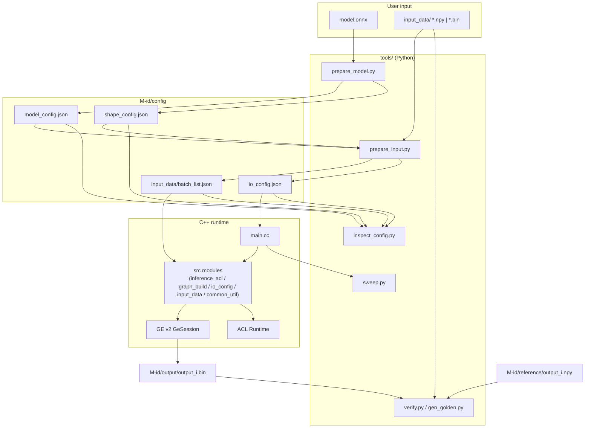
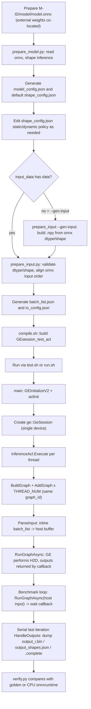

# GE_SESSION_DEMO

An online inference framework built on GE Session (v2 `GeSession` + `RunGraphAsync`). The input is a
`model.onnx` plus one request of data; the framework analyzes the model, normalizes inputs, generates
configuration and runs inference. Model adaptation is fully configuration-driven, with no model
branching in the C++ code.

- Model agnostic: adding a model only touches data and configuration, not code.
- Configuration driven: `model_config.json` / `shape_config.json` / `io_config.json` / `batch_list.json`.
- Full toolchain: model analysis, input normalization, config inspection, accuracy verification,
  concurrency/core-limit sweep, profiling.

---

## 1. Architecture overview



---

## 2. End-to-end flow



Steps `B`–`F1` above can be done in one command with `prepare.sh` (see §4 Quick start and §8 Toolchain);
when no input data is available, add `--gen-input` and `prepare_input.py` builds inputs from the onnx
dtype/shape automatically; non-batch dynamic dims require `GEN_INPUT_SHAPE` / `--input-shape`.

### Runtime call sequence

```mermaid
sequenceDiagram
    participant M as main
    participant S as ge::GeSession
    participant A as InferenceAcl
    participant R as ACL Runtime
    M->>M: GEInitializeV2 / aclInit
    M->>S: new GeSession(device)
    M->>S: BuildGraph: aclgrphParseONNX(model, INPUT_SHAPE, OUT_NODES)
    M->>S: AddGraph(graph_id) x THREAD_NUM
    M->>A: new InferenceAcl(io, session, graph_id, index, device, stats, stop)
    A->>R: aclrtSetDevice
    A->>A: ParseInput: batch_list -> host tensors (kOnHost)
    A->>S: warmup RunGraphAsync (untimed)
    loop CircleCount
        A->>S: RunGraphAsync(graph_id, host inputs)
        S-->>A: callback(outputs) / wait future
        A->>A: statistics; serial last iteration HandleOutputs dump
    end
    M->>M: GEFinalizeV2 / aclFinalize
```

---

## 3. Directory layout

```
demo/
├── compile.sh                     build -> ./GEsession_test_acl
├── test.sh                        run entry (env-driven, sectioned comments)
├── run.sh                         convenience entry (long options, calls test.sh)
├── prepare.sh                     model preparation entry (wraps prepare_model + prepare_input)
├── GEsession_test_acl             build artifact
├── src/
│   ├── main.cc                    GEInitializeV2/ACL, GeSession, AddGraph on same graph_id, thread orchestration
│   ├── common_util.h/.cc          env vars, JSON, shape helpers
│   ├── io_config.h/.cc            InputCfg/OutputCfg/IoConfig, loading, dtype mapping
│   ├── input_data.h/.cc           InputDataBase / InputData<T>
│   ├── graph_build.h/.cc          BuildGraph: parse onnx/tf + hint options
│   └── inference_acl.h/.cc        executor: ParseInput(host) + RunGraphAsync loop + serial last-iteration dump
├── tools/
│   ├── common.py                  shared path/dtype/onnx/JSON library
│   ├── prepare_model.py           onnx -> model_config.json + shape_config.json
│   ├── prepare_input.py           input normalization -> batch_list.json + io_config.json
│   ├── inspect_config.py          config inspection report
│   ├── gen_golden.py              generate golden with CPU onnxruntime
│   ├── verify.py                  accuracy verification (golden source + per-output gate)
│   ├── check_provenance.py        model/input/golden/config fingerprints
│   └── sweep.py                   automatic core-limit/concurrency sweep
├── doc/                           README_EN
└── models/                        model workspace root
    └── M<id>/                     per-model workspace
        ├── M<id>_env.sh           model-specific environment (sourced by test.sh)
        ├── model/model.onnx       user-provided
        ├── input_data/            inputs and batch_list.json
        ├── config/                model_config/shape_config/io_config
        ├── output/                outputs and verification report
        ├── reference/             accuracy golden
        ├── report/                inspect report
        ├── sweep/                 sweep logs and reports
        └── .cache/                runtime temporary area
```

---

## 4. Quick start

Minimal steps to onboard a new model:

```bash
cd demo

ID=<id>            # replace with your model id, e.g. 001

# 1. Place model (required) and inputs (optional)
#    models/M$ID/model/model.onnx              required; external weights must be co-located
#    models/M$ID/input_data/<onnx input name>.npy   optional; use --gen-input if absent

# 2. One-shot preparation: analyze model + generate configs + normalize inputs
bash prepare.sh $ID              # with no input data: bash prepare.sh $ID --gen-input

# 3. Build (first time or when source changes)
bash compile.sh

# 4. Run
bash run.sh $ID                  # equivalent to MODEL_ID=$ID bash test.sh
```

The preparation can also be split manually for finer control (`prepare.sh` wraps exactly these):

```bash
python3 tools/prepare_model.py $ID               # config/model_config.json + shape_config.json
vi models/M$ID/config/shape_config.json          # edit static/dynamic policy if needed (see §6)
python3 tools/prepare_input.py $ID [--gen-input] # input_data/batch_list.json + config/io_config.json
```

`run.sh` is equivalent and more concise:

```bash
bash run.sh $ID --threads 4
```

---

## 5. Workspace convention

The workspace directory is `M<id>`; `model_id` is the id without the `M` prefix.

```
models/M<id>/
├── M<id>_env.sh                  model-specific environment (sourced by test.sh)
├── model/model.onnx              model (external weights, if any, must be co-located)
├── input_data/                   input data
│   ├── <onnx input name>.npy     recommended, self-describing shape/dtype
│   ├── <onnx input name>.bin     optional, auto-convertible only for fully static onnx inputs
│   └── bin_spec.json             optional, shape/dtype declaration for .bin
├── config/
│   ├── model_config.json         generated by prepare_model.py
│   ├── shape_config.json         generated by prepare_model.py, user-editable
│   └── io_config.json            generated by prepare_input.py, read by C++
├── output/                       output_i.bin, output_shapes.json, .complete, verify_report.json, verify_table.log
├── reference/                    accuracy golden output_i.npy / .bin
├── report/                       inspect_config.py reports
├── sweep/                        sweep.py results
└── .cache/                       runtime temporary area
```

### Input conventions

- The file name equals the onnx input name; array shape is the actual request shape.
- `.npy` is preferred; when both `.npy` and `.bin` exist, `.npy` is used.
- `.bin` is auto-convertible only when the onnx input dims are fully static; with dynamic dims provide
  `.npy`, or declare it in `input_data/bin_spec.json` as
  `{"<name>": {"dtype": "float32", "shape": [1, 50, 1]}}`.
- With no input data, `bash prepare.sh <id> --gen-input` builds `<name>.npy` from the onnx dtype/shape
  (fixed seed, reproducible). Non-batch dynamic dims require `GEN_INPUT_SHAPE="name=d0,d1,..."`;
  otherwise it fails clearly.
- Input order follows onnx `graph.input`; `batch_list.json` is ordered accordingly.

### Supported dtypes

`float32`, `float16`, `bfloat16`, `int32`, `int64`, `bool`.

- `float16` / `bfloat16` are passed losslessly as uint16 bit patterns.
- `bfloat16` input npy may be `ml_dtypes.bfloat16`, `uint16`, or a 2-byte bit container.
- Other dtypes warn in `prepare_model.py` and fail in `prepare_input.py`.

---

## 6. Configuration

### model_config.json

Generated by `prepare_model.py` from onnx; read-only reference.

| Field | Description |
|---|---|
| `model_id` / `model_file` / `framework` | identity and path |
| `graph_name` / `ir_version` / `producer` | onnx metadata |
| `inputs[]` | `index`, `name`, `dtype`, `elem_bytes`, `onnx_shape`, `dynamic_dims`, `symbolic` |
| `outputs[]` | same as above |
| `extra` | `initializer_count`, `opset`, `shape_inference` |

### shape_config.json

Static/dynamic policy, user-editable.

| Field | Description |
|---|---|
| `mode` | `all_static` (default) pins all inputs to their actual shape; `all_dynamic` passes no INPUT_SHAPE; `custom` uses `overrides` |
| `batch_size` | batch baseline. **Under `all_static`, for inputs whose onnx axis 0 is dynamic, data is tiled/truncated along axis 0 to this value**, i.e. `batch_size=100` yields a static `[100,...]` graph. No effect under `all_dynamic` |
| `default_parser_dynamic_value` | placeholder for dynamic dims in parser_shape, default `-1` |
| `overrides` | `<input name>` -> `{"dynamic": [bool...]}` or `{"shape": [...]}`; in `shape` a positive value pins the dim and `-1` means dynamic. Only axis 0 (batch) set to `-1` is expanded/truncated by `batch_size`; other dims must match the actual data. The automatic `batch_size` expansion only applies when no explicit `shape` is given |
| `output_overrides` | `<output name>` -> `{"shape": [...]}`, `{"dims": [...]}`, `{"dtype": "..."}`. **Usually unnecessary**: dynamic output dims may stay as `-1` placeholders and GE's runtime shape is authoritative (see below) |

`dims` expressions derive output dims from inputs and support integers and
`{"from_input": "<input name>", "dim": i}`.

### Three input scenarios (all_static / all_dynamic / custom)

The same onnx graph may see different request shapes. `shape_config.mode` decides **whether input shapes
are frozen for GE at build time** (i.e. how `parser_shape` is produced, see
`tools/prepare_input.py::resolve_parser_shape`):

| mode | parser_shape rule | Pass `INPUT_SHAPE`/`OUT_NODES`? | Use case |
|---|---|---|---|
| `all_static` (default) | every input uses its actual data shape; a dynamic onnx batch dim becomes concrete via `batch_size` | yes | fixed request shape, bounded memory (preferred) |
| `all_dynamic` | no shape constraint generated (parser records `-1`) | no | highly variable shapes, avoid recompiles; workspace may be large |
| `custom` | only dims marked `overrides[name].dynamic=true` stay dynamic, others use data dims | yes | mixed (e.g. dynamic batch, fixed sequence length) |

- `parser_shape` is different from the data shape `runtime_shape`: the former is a build-time hint for GE,
  the latter comes from the `.npy` (or `--gen-input`).
- **`all_static` batch semantics**: when onnx axis 0 is `-1`, `batch_size` is authoritative — the data is
  expanded/truncated to `batch_size` and parser_shape becomes `[batch_size, ...]`. So changing `batch_size`
  tests a different static shape (default 1 → `[1,...]`, 100 → `[100,...]`).
- **`all_dynamic` batch semantics**: parser_shape stays `[-1,...]`; `batch_size` is not frozen. A concrete
  data array is still fed.
- **Dynamic output dims**: no manual fill needed. `io_config.outputs[].shape` may keep `-1`; GE decides the
  real shape at runtime and writes it to `output/output_shapes.json`, which `verify.py` uses. If a static
  io_config shape conflicts with the runtime shape, the runtime prints `[GE OUTPUT][WARN]` and continues with
  the runtime shape.
- The placeholder for dynamic dims in parser_shape is `default_parser_dynamic_value` (default `-1`).
- `mode` only takes effect at generation time; after changing it you must **rerun `prepare_input.py`**
  (parser_shape is baked into `io_config.json`). `run.sh` does not expose `mode`.

**All static (default, nothing to set)**

```bash
bash prepare.sh $ID --mode all_static
bash run.sh $ID --verify            # tests the static shape at batch_size=1, [1,...]
bash run.sh $ID --batch 100         # tests a [100,...] static shape (input auto-expanded)
# expect io_config.json: "pass_input_shape": true
```

**All dynamic**

```bash
bash prepare.sh $ID --mode all_dynamic --force     # --force needed to rebuild an existing shape_config
grep pass_input_shape models/M$ID/config/io_config.json   # expect false
bash run.sh $ID                                     # parser_shape stays [-1,...]
```

**Mixed (custom)** — edit `models/M$ID/config/shape_config.json`:

```json
{
  "mode": "custom",
  "batch_size": 1,
  "default_parser_dynamic_value": -1,
  "overrides": {
    "input_ids":      {"dynamic": [true, false]},
    "attention_mask": {"dynamic": [true, false]},
    "token_type_ids": {"dynamic": [true, false]}
  }
}
```

The example means axis 0 (batch) is dynamic (parser writes `-1`) while axis 1 (sequence length) is fixed
to the actual data. Then run `bash prepare.sh $ID --input-only` to regenerate `io_config.json`.

**Testing and observation**

- Static/dynamic check: `shape_mode` / `pass_input_shape` printed by `bash run.sh $ID --show`, or the
  `shape_mode` and `inputs[].parser_shape` in `io_config.json` (dynamic dims are `-1`).
- Accuracy: `bash run.sh $ID --verify` (serial single-thread only).
- Build result: `bash run.sh $ID --dump_graph`, then inspect `models/M$ID/.cache/dump_graph`.
- Performance: `bash run.sh $ID --prof ge|msprof`.
- Config consistency: `python3 tools/inspect_config.py $ID`.
- Note: `tools/sweep.py` only sweeps `batch_size`, not `mode`; switch mode via the preparation flow above.

### io_config.json

Aggregated by `prepare_input.py`; the single input/output configuration source for the C++ runtime.

| Field | Description |
|---|---|
| `model_id` / `framework` / `batch_size` | `model_id` is only printed; `framework` selects the graph parser (currently `onnx`); `batch_size` is the batch expansion baseline |
| `model_file` / `batch_list` / `output_dir` | paths relative to `GE_DEMO_ROOT` |
| `pass_input_shape` | whether to pass `INPUT_SHAPE` to GE |
| `shape_mode` | records the policy source (printed only) |
| `inputs[]` | `index`, `name`, `dtype`, `elem_bytes`, `parser_shape`, `hint_shape`, `runtime_shape`, `dynamic_dims` (`index`/`dtype`/`elem_bytes`/`runtime_shape`/`dynamic_dims` are tool/record fields, not read by C++) |
| `outputs[]` | `index`, `name`, `dtype`, `elem_bytes`, `shape`, `resolve`, `size_bytes`. `shape` may contain `-1` (dynamic placeholder); `size_bytes` is then `null`; the real shape is written by the runtime to `output_shapes.json` |

Field-to-C++ behavior mapping:

| io_config field | Use |
|---|---|
| `inputs[].parser_shape` | build `INPUT_SHAPE` |
| `inputs[].hint_shape` | build `ge.inputHintShape` |
| `pass_input_shape` | whether to set `INPUT_SHAPE` |
| `outputs[].name` | build `OUT_NODES` and determine output count |
| `outputs[].index` | written to `output_shapes.json` |
| `outputs[].elem_bytes` | compute dumped byte size |
| `outputs[].dtype` | printed (for verify; C++ does not use it to interpret callback outputs) |
| `outputs[].shape` | expected/hint (may contain `-1`; **not read by C++**). The runtime uses the real shape; a conflict with a static declaration prints `[GE OUTPUT][WARN]` and keeps the real shape |
| `outputs[].size_bytes` | **tool check/record** (`null` for dynamic outputs; not read by C++) |
| `model_file` / `batch_list` / `output_dir` | path resolution |
| `output_shapes.json` (runtime artifact) | real output shapes; `verify.py` uses it to interpret `output_i.bin` |

### batch_list.json

Inline array ordered by onnx input order; each item contains:

| Field | Description |
|---|---|
| `ori_name` | input name |
| `dim` | runtime shape |
| `item_feature` | expand by batch when `1`, keep as-is when `0` (currently `prepare_input.py` always writes `0`; expansion is done during generation) |
| `size` | byte count |
| `ori_batch` | original batch |
| value keys | `float_val`, `float16_bits`, `bfloat16_bits`, `int32_val`, `int64_val`, `bool_val` |

---

## 7. Run entries

### compile.sh

Compiles and links `src/*.cc` (`main.cc` and the feature modules) into `./GEsession_test_acl`. It depends
on CANN `libascendcl`, `libgraph`, `libge_runner_v2`, `libge_compiler`, `libgraph_base`, `libge_common`,
`libfmk_onnx_parser`.

Host architecture is auto-detected: `ARCH=$(uname -m)` (`aarch64` / `x86_64`); the CANN root is taken from
`CANN_HOME` or `/usr/local/Ascend/ascend-toolkit/latest`; `libascendcl.so` is located under
`<arch>-linux/lib64`, `lib64`, then `<arch>-linux/devlib`, with an explicit error if not found.

C++ uses the system header `nlohmann/json.hpp`, which is not bundled. Install it before the first build:

```bash
dnf install -y nlohmann-json-devel
```

Once `/usr/include/nlohmann/json.hpp` exists, no extra `-I` is needed.

### test.sh

Env-driven run entry, organized in sections:

| Section | Variables | Defaults |
|---|---|---|
| Common env | `PYTHONPATH` / `LD_LIBRARY_PATH` / `CPLUS_INCLUDE_PATH` | CANN and python site-packages |
| Workspace | `GE_DEMO_ROOT` / `MODEL_ID` / `GE_DEVICE_ID` | script dir / **required** / 0 |
| Run scale | `DEVICE_NUM` / `START_DEVICE` / `TOTAL_DIE` / `THREAD_NUM` / `CircleCount` / `MaxQPS` / `DebugFreq` | 1 / 0 / 16 / 1 / 1 / 20000 / 1000 |
| Parallelism cap | `GRAPH_MAX_PARALLEL` | 8 |
| Precision/memory | `CORE_NUM` / `FORCE_16` / `ENABLE_HF32` / `KeepDims` | 24\|48 / False / False / False |
| Features | `PrintOutput` / `DumpData` / `PROF` | True / false / off |
| Debug logs | `plogFlag` / `ASCEND_GLOBAL_LOG_LEVEL` | false / 0 (enabled by `--info` or `--debug`) |
| Graph/data dump | `dumpGraphFlag` / `DumpData` | false / false (enabled by `--dump_graph` / `--dump_data`) |
| Model env | `models/M<id>/M<id>_env.sh`, sourced on every run | — |

`test.sh` also auto-adapts to the architecture: it sources `$CANN/set_env.sh` when present
(`CANN_HOME` or `ascend-toolkit/latest`, falling back to the legacy path), derives `CPLUS_INCLUDE_PATH`
from the active `gcc` (`-dumpversion`/`-dumpmachine`, valid on `aarch64`/`x86_64`), and derives
`PYTHONPATH` site-packages from `python3` itself instead of hard-coded versions.

Only a single device is supported: `DEVICE_NUM` must be 1 or startup fails. `TOTAL_DIE` is not exported by
`test.sh`; C++ defaults it to 16 and uses it to wrap `START_DEVICE`. Export it directly to change it.

`models/M<id>/M<id>_env.sh` carries model-specific environment (e.g. extra library search paths) and is
sourced on every run of that model, without affecting other models.

### run.sh

Long-option convenience entry; it parses, exports, then calls `test.sh`.

```
bash run.sh <model_id> [options]

--threads N        --cores "A|V"     --circle N      --debug-freq N
--device N         --batch N
--print-output     --no-print-output
--prof off|msprof|ge                 --verify
--golden-source auto|user|ort        --ref-dir DIR
--graph-max-parallel N
--info             --debug           --dump_graph    --dump_data
--dry-run          --restore
--show             --help
```

`--show` prints the effective configuration and exits, including `shape_mode` and `pass_input_shape`
(ground truth from `io_config.json` when present, else falls back to `shape_config.json` `mode`); `--batch`
first backs up `shape_config.json`, `io_config.json`, `input_data/` to
`models/M<id>/.cache/pre_batch_*`, then updates batch and regenerates inputs. `--restore` rolls back to
the last batch backup; `--dry-run` prints the batch plan without writing. `--verify` calls
`tools/verify.py` after inference and requires a matching
`output/.complete` / `GE_RUN_ID`. `--golden-source user` reads only a manual golden and fails if it is
missing; `ort` uses framework-generated golden; `auto` prefers manual golden then falls back to generated.
`--ref-dir` selects the manual golden directory (default `models/M<id>/reference`).

The runtime console is English with phase tags: `[GE PHASE x/5]`, `[GE BUILD]`, `[GE INPUT]`,
`[GE OUTPUT]`, `[GE RUN]`, `[GE PROGRESS]`, `[GE RESULT]`; when `THREAD_NUM>1` lines are prefixed with
`[T<id>]`. `[GE PROGRESS]` format:
`iter=<done>/<total> | Qps=<..> | avg session run time=<ms> | TP99:<ms> | TP999:<ms>`.

Warmup timeout defaults to 1200s (`WARMUP_TIMEOUT_SEC`); execution timeout defaults to 300s
(`RUN_TIMEOUT_SEC`). A warmup timeout is logged explicitly as `stage=Warmup result=timeout`, because
first-time graph compilation may be slow. If callbacks are still in flight after the timeout, the process
waits `TIMEOUT_GRACE_SEC` (default 30s) and then exits non-zero without running destructors/finalize to
avoid use-after-free.

### Debug log and dump switches (`--info` / `--debug` / `--dump_graph` / `--dump_data`)

`run.sh` provides four switches that set the variables read by `test.sh`:

| Switch | Equivalent variables | Effect |
|---|---|---|
| `--info` | `plogFlag=true`, `ASCEND_GLOBAL_LOG_LEVEL=2` | enable GE plog, **normal logs** (level 2) |
| `--debug` | `plogFlag=true`, `ASCEND_GLOBAL_LOG_LEVEL=0` | enable GE plog, **DEBUG logs** (level 0) |
| `--dump_graph` | `dumpGraphFlag=true` | dump graph (`DUMP_GE_GRAPH=2`, `DUMP_GRAPH_LEVEL=1`, `PRINT_MODEL=1`) to `models/M<id>/.cache/dump_graph` |
| `--dump_data` | `DumpData=true` | enable GE data dump (`ge.exec.enableDump/dumpPath/dumpMode`) to `models/M<id>/.cache/dump_data` |

Notes:

- `--info` and `--debug` only enable plog; they differ in level. When both are given, `--debug` (level 0)
  wins.
- With any switch on, stdout/stderr is saved to `models/M<id>/report/run_debug_<timestamp>.log` (path and
  size printed at the end); device plog is still written by CANN to its default log directory.
- `models/M<id>/.cache/dump_graph` and `models/M<id>/.cache/dump_data` are created by `test.sh` via
  `mkdir -p` before launch (`test.sh:112`) and exported as `DUMP_GRAPH_PATH` / `GE_DUMP_PATH`, so
  `--dump_data` does not fail on a missing directory.
- All four switches default to off.

```bash
bash run.sh 007 --info                 # normal logs (level 2)
bash run.sh 007 --debug                # DEBUG logs (level 0)
bash run.sh 007 --dump_graph           # graph dump only
bash run.sh 007 --dump_data            # data dump only
bash run.sh 007 --debug --dump_graph --dump_data   # combined
```

You can also bypass `run.sh` and export variables directly:

```bash
ASCEND_GLOBAL_LOG_LEVEL=2 plogFlag=true MODEL_ID=007 bash test.sh
dumpGraphFlag=true DumpData=true MODEL_ID=007 bash test.sh
```

---

## 8. Toolchain

### prepare_model.py

```bash
python3 tools/prepare_model.py <id> [--mode all_static|all_dynamic|custom] [--batch-size N] [--force]
```

Reads onnx, runs `onnx.shape_inference`, and generates `model_config.json` plus a default
`shape_config.json`. An existing `shape_config.json` is kept unless `--force` is given.

### prepare_input.py

```bash
python3 tools/prepare_input.py <id> [--adopt-output-shapes] [--gen-input]
                                  [--input-shape NAME=D0,D1,...]...
```

Validates and normalizes inputs, applies the `shape_config` policy, and generates `batch_list.json` and
`io_config.json`. `--adopt-output-shapes` backfills actual output shapes from `output/output_shapes.json`.

`--gen-input`: available **only when `input_data/` is empty**; it generates `<input name>.npy` for **all**
inputs, then runs the normal flow. If any `.npy`/`.bin` already exists under `input_data/`, it errors out:
**provided and generated inputs must never be mixed**. Rules:

- Shape: concrete dims as-is; a dynamic axis 0 (batch) takes `shape_config.batch_size`; **other dynamic
  dims must be explicit** via `--input-shape name=d0,d1,...` or `GEN_INPUT_SHAPE` (`;`-separated).
  Missing values now fail with a copyable command instead of silently using 1.
- Dims sharing the same symbolic name get the same value across inputs (keeping multi-input shapes
  consistent).
- Values: three dtype groups — floats use `standard_normal` (`float16`/`bfloat16` cast accordingly, bf16
  prefers `ml_dtypes`); `int32`/`int64` use `[0, GEN_INPUT_INT_MAX)`; `bool` uses 0/1.
- The random seed is a fixed module constant (**not a CLI option**; edit the file top to change it):

  | Constant / env | Default | Meaning |
  |---|---|---|
  | `GEN_INPUT_SEED` | `20240101` | shared seed, reproducible |
  | `--input-shape` / `GEN_INPUT_SHAPE` | none | explicit non-batch dynamic shape; missing fails |
  | `GEN_INPUT_DYN_DIM` | unset | compatibility fallback only when explicitly set |
  | `GEN_INPUT_INT_MAX` | `10` | upper bound for generated integers |

- Limitation: random integers may not satisfy index-range constraints; sequence models needing a real
  length must use `--input-shape` or replace the generated `.npy`.
- Dynamic outputs need no `--gen-input` handling: output dynamic dims stay as `-1` in `io_config` and the
  runtime `output_shapes.json` is authoritative. Write `shape_config.output_overrides` only if you want to
  pin a shape explicitly.

### prepare.sh

```bash
bash prepare.sh <model_id> [--mode all_static|all_dynamic|custom]
                           [--batch N] [--force]
                           [--gen-input] [--config-only] [--input-only]
```

One-shot model preparation entry that fixes the "analyze model → policy → normalize inputs" flow into a
single command. Steps:

1. Validate the workspace `models/M<id>/` and `models/M<id>/model/model.onnx` (`<id>` with or without the
   `M` prefix).
2. Parse the onnx `location` field and verify external weight files are **co-located** with `model.onnx`;
   missing files fail immediately.
3. Run `prepare_model.py` (generates `model_config.json` and default `shape_config.json`).
4. Input stage: if `input_data/` is empty and `--gen-input` is not given, warn and skip; if empty and
   `--gen-input` is given, generate **all** inputs; if non-empty, run `prepare_input.py` validating every
   input, and using `--gen-input` in that case errors out (no mixing).

| Option | Effect |
|---|---|
| `--mode NAME` | `prepare_model.py --mode`, default `all_static` |
| `--batch N` | `prepare_model.py --batch-size` |
| `--force` | overwrite an existing `shape_config.json` |
| `--gen-input` | `prepare_input.py --gen-input`; **requires an empty `input_data/`**, generates all inputs (no mixing) |
| `--config-only` | only run `prepare_model.py`, to edit `shape_config.json` first |
| `--input-only` | only run `prepare_input.py` (after editing the policy) |

`--config-only` and `--input-only` are mutually exclusive and error if combined.

```bash
# with real inputs
bash prepare.sh 101
# only model.onnx, no input data
bash prepare.sh 101 --gen-input
# config first, edit the policy, then generate inputs
bash prepare.sh 101 --config-only
vi models/M101/config/shape_config.json
bash prepare.sh 101 --input-only
```

### inspect_config.py

```bash
python3 tools/inspect_config.py <id> [--ignore-warning] [--fix] [--gen-input]
```

Checks: input list consistency, batch_list order and size, output size, shape_config validity, path
readability, dtype set, onnx input/output name/dtype/shape/dynamic cross-check, value key sampling.
Reports go to `models/M<id>/report/`
(txt + json). Warnings exit with code 2; `--ignore-warning` ignores them; `--fix` reruns
`prepare_input.py`, passing `--gen-input` when `--gen-input` is also given.

### gen_golden.py / verify.py

```bash
python3 tools/gen_golden.py <id> [--ref-dir DIR]
python3 tools/verify.py <id> [--run] [--golden-source auto|user|ort]
                                  [--ref-dir DIR] [--run-id ID] [--gate FILE]
                                  [--rtol R] [--atol A]
```

Golden has two sources only:

1. Manual: `--golden-source user` reads `--ref-dir` (default `models/M<id>/reference`)
   `output_i.npy` / `.bin`; missing files fail and nothing is generated.
2. Framework: `--golden-source ort` generates with CPU onnxruntime into
   `models/M<id>/.cache/golden_ort`; it does not overwrite manual `reference/`.

`auto` prefers manual golden, then falls back to framework generation.

Per-output precision gates are read from `models/M<id>/config/precision_gate.json` by default, or from
`--gate FILE`. Threshold priority is `outputs[name] > default > --rtol/--atol`; the report records the
gate path and each output's actual `rtol/atol`. A missing gate file prints WARN and all outputs use the
global/CLI thresholds.

Tested outputs always come from the framework at `models/M<id>/output/output_i.bin` and require
`output/.complete`; `--run-id` checks the current `GE_RUN_ID` and rejects stale outputs. `--run` cleans
old outputs, re-runs inference, and fails immediately on a non-zero inference return code. Ints and bool
are compared exactly; floats require finite actual output and use `rtol=atol=1e-3` by default. A summary is written to `output/verify_report.json`; details
go to `output/verify_table.log` (5 absolute-error bins + top 30 elements by absolute/relative error;
columns are `rank/position/dtype/expected/actual/abs_err/rel_err%`, and the absolute paths of expected
and actual are recorded; TOP entries and `max_rel_eff` ignore `abs_err<=1e-6`, while the bins still count
all elements).

### check_provenance.py

```bash
python3 tools/check_provenance.py <id> --write          # write config/provenance.json
python3 tools/check_provenance.py <id>                  # compare; exit 1 on mismatch
python3 tools/check_provenance.py <id> --baseline FILE  # compare against a specific file
```

Computes sha256 fingerprints for the model, `input_data/`, `reference/`, `shape_config.json`, and
`io_config.json`, proving that before/after comparisons use the same baseline. Use `--write` once first.

### sweep.py

```bash
python3 tools/sweep.py <id> [--threads 1,2,4] [--core-budget N] [--device 0] [--devices 0,1]
                            [--repeat 3] [--circle 5000] [--debug-freq 1000]
```

Three phases: core tuning (currently fixes the main AIV and uses golden-section search), concurrency
tuning (default 1..8, skip failures), and batch tests (`--batches`). Each config is repeated 3 times;
each run averages a stable window and the three repeats take the median.

A single run is `ok` only when `test.sh` returns 0 and the expected number of samples is present; any
failed repeat marks the config `failed` and excludes it from best selection. Batch preparation failures
abort immediately, and `shape_config.json`, `io_config.json`, `batch_list.json` are restored afterwards.
If `--tp99-limit` has no feasible config, best is cleared and the process exits non-zero.

For the recommended single-device/small-model scenario, `--devices` runs sequentially; device is part of
the cache key. Artifacts go to `models/M<id>/sweep/{logs, sweep_<ts>.csv, report_<ts>.md}`.

---

## 9. Temporary area and artifacts

The runtime working directory is `models/M<id>/.cache/run`, where GE writes `fusion_result.json` and
`kernel_meta`.

| Directory | Content | Retention |
|---|---|---|
| `.cache/run` | GE fusion stats and compile cache | cleared on startup (kept for repeated sweeps of the same config) |
| `.cache/dump_graph` | graph dump | at most 3 |
| `.cache/dump_data` | data dump | at most 3 |
| `.cache/profiling` | profiling artifacts | unlimited |

Collection is off by default and must be enabled explicitly. The temporary area inventory and size are
printed at the end of a run.

---

## 10. Runtime environment

- A working CANN runtime is required; `test.sh` sources CANN `set_env.sh` and sets `LD_LIBRARY_PATH` /
  `PYTHONPATH`.
- `compile.sh` / `test.sh` auto-adapt to the host architecture (`aarch64` / `x86_64`) and the CANN install
  path (`CANN_HOME` or `ascend-toolkit/latest`); no manual path edits are needed.
- Extra runtime dependencies for a model (e.g. custom operator libraries) are injected via
  `models/M<id>/M<id>_env.sh`, sourced on every run of that model; default environment is used when the
  file is absent.

---

## 11. Verified capabilities

| Capability | How verified | Result |
|---|---|---|
| dtype lossless | synthetic Identity model (6 dtypes) | output bit-identical to input |
| Unsupported dtype | uint8 model | prepare_model warns, prepare_input fails |
| Accuracy verification | ort golden (f16/f32/int32/int64/bool), user golden (bf16) | PASS; corrupted output FAIL |
| Config inspection | normal config and injected errors | all green exit 0; warnings exit 2 |
| Temporary area governance | single model run | no GE litter in root, artifacts under `models/M<id>/.cache` |
| Dynamic outputs | expression derivation, probe backfill, conflict detection | pass |
| Dynamic output placeholder | `io_config` output shape keeps `-1`, `verify` reads `output_shapes.json` | PASS (M099 q_feat) |
| all_static batch expansion | onnx batch dim `-1`, `batch_size=2` | input/parser auto `[2,...]` |
| Runtime shape conflict | tampered static output shape in io_config | `[GE OUTPUT][WARN]` printed and execution continues |
| fail-fast | injected size error | non-zero exit, `error.log` recorded |
| Parameterized entry | run.sh `--help/--show` and real runs | pass |
| profiling | `--prof ge` | `PROF_*` directory generated |
| Auto-generated inputs | `prepare.sh --gen-input` with explicit `--input-shape` for multi-input dynamic dims | `.npy` generated and inference succeeds; same-name dynamic dims consistent; missing shape fails clearly |
| External weight check | workspace with a missing weight file | `prepare.sh` fails and prints the expected (co-located) path |

---

## 12. Troubleshooting

| Symptom | Action |
|---|---|
| `GEInitialize failed` | ensure `PYTHONPATH` includes numpy/tbe (test.sh sets it) |
| onnx parse failed | ensure the required custom operator plugin is installed and declared via `models/M<id>/M<id>_env.sh` |
| External-data model | `prepare_model` reads only graph structure/shape (no weight values); at runtime the weight file must be **co-located** with `model.onnx`. `prepare.sh` verifies this and fails with the expected path if missing |
| `Invalid tensor data type` | check the input dtype is in the supported set; run `inspect_config.py` |
| Output directory empty | run with `PrintOutput=True`, or use `verify.py --run` |
| `output/.complete` missing | inference did not finish all writes; check return code and output dir permissions |
| `verify.py` reports stale output | `.complete` run_id differs from `--run-id`; rerun inference or fix the id |
| Only `model.onnx`, no input data | keep `input_data/` empty, then `bash prepare.sh <id> --gen-input` generates all inputs |
| `--gen-input` reports non-empty `input_data/` | it requires an empty dir: provide all real inputs, or clear `input_data/` and regenerate |
| `--gen-input` reports unresolved non-batch dynamic dims | pass `--input-shape name=d0,d1,...` or `GEN_INPUT_SHAPE`; do not rely on the old silent 1 |
| Need to roll back after `--batch` | `bash run.sh <id> --restore` restores the latest `pre_batch_*` snapshot |
| Dynamic output shape | no action needed: `io_config` keeps `-1` and `verify` reads `output_shapes.json`. To pin it, fill `shape`/`dims` in `shape_config.output_overrides` and rerun `prepare.sh <id> --input-only` |
| No accuracy golden | provide `models/M<id>/reference/output_i.npy` (`--golden-source user`), or use `--golden-source ort` / `gen_golden.py` |
| onnxruntime cannot generate golden | model has custom ops or bf16; provide a user golden |
| Device busy | change `START_DEVICE`, or wait for `sweep.py` to time out |
| GE files appear in the root | run through `test.sh`/`run.sh` instead of `GEsession_test_acl` directly |

---

## 13. License

This project is licensed under the **Apache License 2.0**; see `LICENSE`. Copyright and notices are in `NOTICE`.