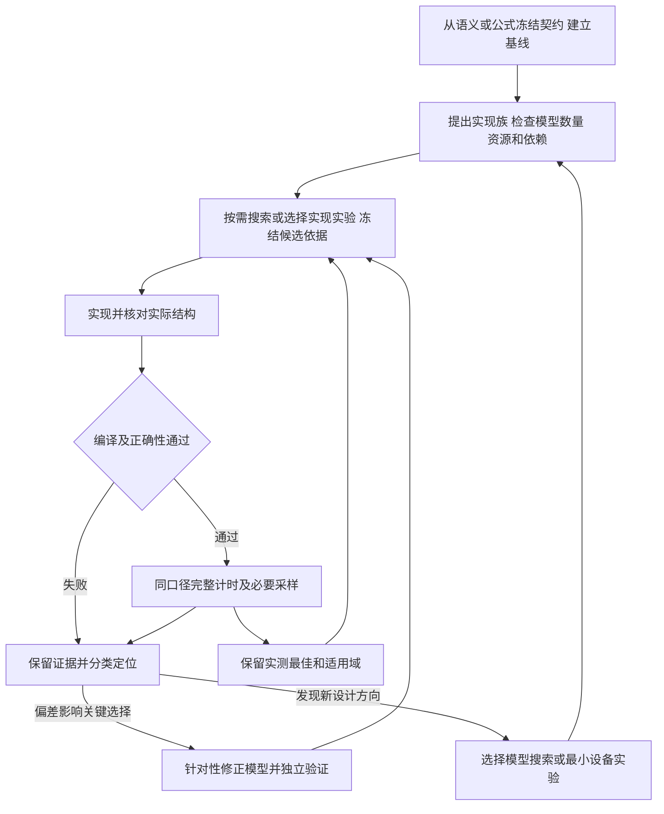

# 联合迭代与证据契约

本参考规定可复用的阶段产物、预测资格与反馈判据。执行范围由当前请求决定；适用阶段已有有效证据时复用它，不要求每轮从头运行。

阅读顺序：新任务从“冻结契约”开始；已有候选从“候选与测前预测”开始；实测反馈从“分类反馈与独立校准”开始；归档按“记录与交付”核对。

## 迭代关系



## 冻结契约与基线

从算子实现、公式和真实调用确定模型、实现、验证与计时共同消费的契约。
尚无算子实现时从公式和接口建立独立参考及可执行起点；已有实现时保留生产
对照，但不把其阶段划分、数据物化、块大小或任务顺序自动视为语义约束。

| 契约 | 需要确定的内容 |
|---|---|
| 数学与接口 | 运算顺序、归约轴、总 shape、dtype、布局、广播、舍入/饱和/量化、输出和原地别名 |
| 支持范围 | 单 shape 或 shape 集合、尾块、动态维度、稀疏/掩码、可变参数；按真实语义选择边界 |
| 正确性 | 独立参考与版本、比较规则、绝对/相对误差或整数精确要求、统计指标及允许的非有限值语义 |
| 副作用 | 有状态时明确更新范围、未触及区域及连续调用；无状态时标记不适用 |
| 性能目标 | 完整算子延迟/吞吐、生产对照、当前最快实现、多 shape 汇总权重或合法分发规则 |
| 成本边界 | 准备、运行、编译、传输、预处理、初始化及附加 kernel 的计入规则，地址与缓存条件 |

不要将某个案例的 isclose 比例、epsilon、随机种子或状态 sentinel 升格为通用标准。随机算子按其语义固定或统计检验随机性，不能强求本不保证的逐位确定性。独立数值参考不应直接复用候选实现的同一错误路径。

精度标准在候选开发前固定。改变算法、累加顺序或舍入边界仍需原标准通过；需要变更目标时作为独立语义变更记录。必需的在线转换和初始化计入运行；只有满足复用条件的一次性准备才能单列，并注明摊销次数。无生产基线时明确记录，不能报告相对生产实现的加速比。

**进入条件：**参考、正确性驱动、计时边界及基线身份可核对。只有模型证据而无设备条件时，可继续授权的模型分析，设备基线与性能结论保持未验证。

## 模型数量、结构与能力

新模型或新模板按目标项目的要求组织；已有模型先恢复固定点。OpModel 的模型定义、分核及 CLI 选择见[工具路由](tool-routing.md)。

分别核对：

1. **数学工作量**：有效计算、padding 或重复执行的计算、归约与中间表示。矩阵 MAC、向量操作、整数/位操作按各自口径记录，不把所有算子换算成同一种峰值。
2. **实现数量**：实际指令粒度和条数、分路由字节、布局与对齐、读写/转换、全局内存往返、任务覆盖和核间不均衡。
3. **资源与依赖**：物理 buffer 的槽数和存活字节、owner/region/version、生产者与全部消费者、重用释放、跨核交接及调用边界。逻辑 pool 名不能增加物理容量。
4. **成本资格**：理论参数、受控测量、拟合参数和未知项分别标记。数值参考、估计值和实际运行结果保持身份区别。

稀疏、筛选、压紧或条件执行方案按适用环节记录“原始候选 → 分片候选 → 共享计算并集 → 对齐后的实际指令与搬运量”，同时计入重复执行、压紧／gather、必要精算和回退路径。不适用的环节注明，不为满足模板虚构操作。先用独立参考或工作量回放核对真实调度，再做设备预算；稀疏率不能直接充当设备算量比例。保存输入集、逐核／逐分片分布及快慢路径条件，采用改变分片或输入范围的方案后重新核对。回放轨迹的预算只适用于该轨迹，不能声称已覆盖任意运行时分支。

检查固定 case、适用的多任务/多组/尾块和资源释放，再验证可搜索参数贯通 workload、分核、指令和容量。支持执行一个固定图，不表示支持任意结构变换；只含一个候选的重放不记为完成搜索。

双后端对拍验证共享模型的一致性，小规模数值检查验证声明语义；它们不能独立证明设备地址安全、编译部署可行或硬件服务时间准确。无法表达的结构保留能力缺口，不通过删依赖或虚构带宽绕过。

## 候选与测前预测

候选包含参数、分核、数据流、布局、存储、同步和可实现的收益机制。用稳定 candidate ID、父候选及内容签名绑定记录；参数或结构变化后产生新版本。实现后端、生成代码或编译版本另用 implementation ID 区分。

先从数学语义和硬件推导实现族，再按需要搜索参数与映射或设计实现实验。主动考虑不同的分解/融合、
物化与重计算、驻留、规约和流水方案，避免仅改变现有算子实现中的几个常量。
每个假设写清等价依据、资源代价和可否被证伪；从公式开始的设计走
[公式到模型](tool-routing.md#从公式建立模型)，最终同样需要实现与设备验证。
改变中间缓存等公开输出时必须满足已冻结接口，不能把接口变化当作等价优化。

| 假设或证据来源 | 登记方式 |
|---|---|
| 模型搜索 | 搜索空间、有效参数、评分版本、候选集合与排名；说明空间由谁定义 |
| 算子实现/编译审查 | 语义、约束、生产对照、实现假设及适用的模型到指令映射；不记为实际搜索 |
| 设备反馈 | 对照采样、瓶颈证据及尚未排除的解释 |
| 用户或理论分析 | 原始建议/推导、适用条件、可表达性与失败信号 |

**实现选择依据：**opmodel 搜索由 agent 按需要选择，候选也可来自语义推导、源码审查或设备反馈。
实现前保存父候选、预期机制、新增代价、失败信号及选择理由；直接实验不要求先补模型。
选择模型搜索时，保存空间/动作声明、命令与配置身份、基线和候选、合法性结果、实际评分与选择理由。
所选搜索范围内的切分、分核、缓冲和流水配置按[内置搜索器接入](tool-routing.md#内置搜索器接入)
实际搜索，分别记录已搜维度、固定维度及理由、未覆盖空间和成本资格。外层提出结构，
内层搜索配置，随后对搜索结果做完整 case 复评；`run_experiment` 的固定候选排名
不能替代内层搜索。空结果、单点退化或仅接入短序列均须明确报告，不记为搜索完成。
结构假设可以由代理自主设计，随后通过适用的 `agent_search`/`graph_search` 或参数
搜索入口比较；只登记假设、单点重放或局部 `CycleModel` 分析均不记为实际搜索。
模型缺失或关键差异不可表达时明确缺口，按其对下一步决策的价值选择补接入或直接实验。
为核对可实现性或未知成本而做的最小实验是接入证据，不是已选出的完整性能候选。

先记录预计减少的工作或等待、新增代价及完整关键路径，再选择实现集合。比如减小 tile 可能改善交接，又增加指令、重复加载和控制开销；只减少字节或运算条数不能推出完整耗时降低。

昂贵实现前，先用[乐观上界与最小判别实验](experiment-economy.md#实现前选择最小判别实验)筛掉没有足够收益空间的具体方案，并优先验证会使其无法落地的布局、交接或数值假设。VF 成本可使用有依据的实测、系数/公式或可选预测，按[VF 成本契约](../framework/vf-costs.md)保留实现、输入、来源及适用域。预测只进入支持它的独立排名，不升级为实测校准。未知成本可用范围分析决定下一项实验，但不能以敏感性扫描填补有效评分所需的成本；范围足以反转选择时先补证据。

同一模型排名固定 case、硬件、成本内容、缓存/共享资源假设、执行后端、计时范围和框架版本。理论估算、校准预测和设备实测分开。保存当前实测最佳、模型 Top-K 与少量能区分竞争解释的候选，数量由本轮预算决定。

候选预测差距小于适用范围内的已知误差或测量波动，或关键成本尚未验证时，
暂不依据名次判定优劣。没有误差数据时标记“排序可信度未知”，不人为设置通用百分比，
也不把其他形状或路径的误差直接作为本轮阈值。

此时在同口径实际已评分集合中按机制选择代表，而非机械截取前 K 名：

- 保留当前实测最佳作为控制，再比较候选的分块、实际指令数量、数据复用与同步方式。
- 在预算内覆盖有实质差别的方案，避免全部名额都给同一种结构的相邻参数。
- 反例围绕待验证解释选择。例如细块可能更早交接但增加指令和重复供数，
  可选择较粗块对照；复用可能减少搬运但增加等待，可选择不同复用或同步方式对照。
  每个对照注明它能区分什么解释，尽量保持其他条件一致。

存在测前预测时保存不可变快照或版本/哈希及创建时间。未选择搜索时记录理由，模型成本域外或评分入口不可用时明确标记限制；不能将实现假设当成模型预测。用户明确要求的搜索仍须完成或报告未完成项。测后补建模型只记为解释或固化，不回填为模型事先提出或预测命中。

## 实现、正确性与结构对应

实现后核对实际块尺寸、核数、复用、指令/copy 粒度、布局、缓冲与同步；必要时检查生成代码、原生指令或编译器报告。源参数存在不等于实际生效。

编译约束迫使结构变化时，记录偏差并更新候选/实现对应关系，重新核对数量和依赖。有相同结果但不同结构的程序，不作为原预测的直接验证。

出现编译拒绝、同步不返回或范围错误时，按[症状选择下一步](experiment-economy.md#按症状减少重复试错)，先取能定位根因的最小证据，再扩大 case。实际核心指令、编译选项和调用条件等价的变体合并为同一性能候选，保留各自源码身份；仅有二进制哈希不同也不能证明计算结构不同。

先验证输出与适用的状态、副作用、别名、边界和数值范围。涉及 scratch 或异步复用时，使用不同输入连续调用、独立结果保存及适用的 poisoned 缓冲检查，避免相同数据掩盖旧值。失败实现保留证据，但不进入正确实现的性能排名；诊断性采样不得表述为有效加速。

**进入性能选优的条件：**编译、原正确性标准和本轮必须覆盖的行为通过，实际结构及源码/二进制身份已记录。

## 完整计时与必要采样

同轮保留完整基线和当前最快实现。记录 warmup、调用次数、轮次、候选顺序、全部原始样本、内存地址/分配、缓存模式、设备和频率资格；次数与重复方式按本轮收益量级和预算选择，不固定照搬某个案例。

在可比条件下比较完整延迟或吞吐，检查收益相对波动是否稳定。新布局或额外准备无法统一地址时说明差异。对微小改进可采用交错/反向顺序和独立重复；未取得足够证据时保留候选，不只取最小样本提升默认。

Profiling 围绕假设采集对照、赢家与关键反例。记录总核数、空核、任务分布、频率、实际指令/字节、pipe 服务和等待。均值、最重核、逐核独立与全核共享口径分开；各 pipe 的 busy 可重叠，不能相加为完整耗时。插桩采样和无插桩计时不互相替代。

| 指标 | 使用条件 |
|---|---|
| 完整延迟/吞吐 | 所有算子的主要实现指标；多 shape 提前固定汇总方式，保留逐 case 回退 |
| MFU | 有明确有效 FLOPs 和对应 dtype/执行单元峰值时报告；纯搬运、整数或无法匹配峰值的算子标记不适用 |
| 有效带宽/MBU | 标明是最小逻辑流量、实际执行路由流量还是设备 HBM 流量；冷热缓存和分母口径可核对 |
| 服务占用与等待 | 用于归因，标明采样与统计定义；不能用利用率高低单独判定瓶颈 |

未知硬件计数或实际频率写“未知”。理论峰值保持物理标称口径，拟合后的可达服务率另存；不能调低 MFU 分母制造提升，也不能把热缓存访问量当成实测 HBM 吞吐。

## 分类反馈与独立校准

先写观察、证据与待验证解释，再决定修改哪一层。

模型修正与 DSL 优化按下一轮决策需要安排：

- 偏差影响下一轮关键方案选择时，优先做有针对性的建模修正，范围由证据限定。
- DSL 反馈或代理推导的新方向，由 agent 判断是否需要模型搜索，也可直接进行实现实验。
  最小编译、数值或成本实验可帮助判断可行性，不要求先校准全部硬件服务项。
- 原精度通过且完整耗时稳定改善时，可以接受实现；模型是否完成校准单独验收。
  设备收益不证明模型搜索或校准完成；接受模型修正仍需独立验证。

**重要实现变化后重新声明模型适用范围。** 采用改变数据流、驻留、分片或主要 VF 的实现后，核对当前模型的结构、数量、依赖和成本是否仍对应它。在既有迭代记录中注明覆盖部分、缺项及后续用途：需要继续完整预测或排序时更新模型并验证；暂不更新时只用于仍有效的局部服务预算或约束分析，不借用旧模型结果给新实现完整排名。完整预测、局部服务预算与乐观上界分开报告；不强制每轮重建完整模型，也不因模型暂缺阻止已有正确性与稳定设备收益证据的实现被采用。

| 分类 | 典型现象 | 下一步 |
|---|---|---|
| 语义/实现 | 输出、状态、别名或连续调用失败 | 查舍入、索引、算法及实际同步，回到契约或实现 |
| 数量 | 计算、路由字节或指令漏算/重复 | 修正 workload、分核和参数投影并重核数量 |
| 部署约束 | 字节容量合法但编译器拒绝 buffer 身份、切片或指令 | 保存编译证据，增加带版本适用域的合法性约束 |
| 服务成本 | 数量相符，指令或管线服务预测不符 | 验证形状、粒度、布局、启动及可达速率假设 |
| 执行结构 | 服务合理，完整时间仍系统性偏差 | 查就绪、发射、等待、资源共享、屏障与关键路径 |
| 证据资格 | 源码、case、计时范围、频率或访问方式不一致 | 先恢复可比性；不将混合记录用于成本拟合 |

理论带宽与吞吐用于量级检查和理想下限。完整时间接近实测可能来自误差抵消；完整残差也不能全部计入某一 pipe 或 Scalar。对有依据的服务项，可探索：

```text
服务周期 = 固定启动成本 + 实际服务工作量 / 可达服务率
```

工作量可为 MAC、向量批次、对齐字节或实际事务，按操作定义。尺寸、指令数、stride、格式转换、端口冲突、缓存和多核共享会影响服务；同步和控制也需独立证据，不能默认零成本即实际免费。避免将同一启动或等待在多个项重复计费。

采用“数量 → 分项服务 → 完整结构 → 选优”的校验顺序。受控样本应能区分固定开销、吞吐和结构影响，选择可辨识的简单模型，不能仅从几个完整耗时同时拟合全部参数。

冻结训练集与未参与拟合的验证集，分别记录硬件、频率资格、shape、dtype、layout、访问模式、源码和编译版本；另保留域外反例。跨域时标记未知/域外或拒绝套用，不自动继承旧系数。

模型修正独立验证通过后，用新版模型重放原已测候选集，检查原误排序是否改善，再用新版模型指导新候选选择。参数更新、适用域扩大、共享默认推广分别记录。失败修正保留，原有效模型不被无证据覆盖；有明确方向的实现验证可按上述原则继续。

## 记录与交付

可沿用现有 JSON、YAML 或报告格式，以下是字段契约，不表示框架已有统一自动执行接口。

| 记录 | 内容 |
|---|---|
| 候选 | ID/父候选/假设来源、case 契约、实现族与代价、参数/结构/布局/同步、是否使用搜索及理由、使用时的搜索运行/评价 ID、候选集合及选择依据、适用的模型与成本身份、数量/容量/部署检查、预测或未预测的说明 |
| 实现与测量 | candidate/implementation ID、实际结构及偏差、源码/生成代码/二进制哈希、编译环境、正确性、计时边界/顺序/样本、Profiler 口径、计数和频率资格 |
| 反馈 | 证据对应关系、观察/假设/分类、修正范围、训练/验证/域外样本、成本版本与适用域、前后误差/排序、采纳或保留理由 |

对停止或合并的候选，补充“淘汰层次、最小反例、重新打开该方向需要什么新证据”；字段可沿用现有报告，不另建重复台账。未通过原精度、无法完成、成本未知与实测更慢分别记录，防止下一轮重复实现已被同一证据否定的变体。

有编译或二进制时记录相应身份；没有的字段标明不适用。模型可行性、成本资格、实现正确性和性能结论是独立字段。可分别使用 `model_rejected`、`cost_out_of_domain`、`compile_failed`、`accuracy_failed`、`validated`、`measured_slower`、`measured_best` 等标记；精度通过与成本未知可以同时成立。

分别交付：

- **实现结果**：在声明范围及已测集合中的最佳正确实现、固定配置、同轮收益、支持范围及复现入口；多 shape 选择单配置或分发策略时保留对应规则和总代价。
- **模型结果**：结构/数量修正、成本版本、独立验证、预测及排序误差和能力缺口；没有有效修正也保留反例。
- **运行状态**：标准固定运行、搜索、导出回读和相关测试分别完成到哪一步；预算耗尽或用户暂停不等于目标完成。

模型驱动联合寻优的完成结论必须包含实际搜索证据及其到实现/设备结果的映射。
未使用搜索时报告实际实现探索与设备结果，不宣称模型驱动；优化目标是否完成由用户目标
及完整实测验收决定，不因搜索可选而缩小目标。只调过现有模板参数时注明结构探索未执行。
从公式开始的任务交付独立参考、自主方案及可运行实现；模型产物仅在实际使用时交付，不止设计建议。

用户算子实现、配置和紧凑证据保存在用户项目；权重、构建缓存、大型 trace 和原始日志按该项目规则放置，并保存来源与哈希。不要把任务运行记录写回发行资料目录。使用新运行目录，避免覆盖旧证据。实测赢家与模型第一名分别保存，不以候选 ID 或完整耗时倍率强行拟合赢家。

## 衡量是否相互改进

在同一已测、精度有效且可比的候选集合上，固定目标与 Top-K 的 K 值及近优容差后计算：

```text
预测相对误差 = (预测耗时 - 实测耗时) / 实测耗时
误选损失 = 模型选中方案的实测耗时 / 集合中最佳实测耗时 - 1
```

同时报告分项与完整误差、Top-K 近优覆盖，以及获得一次有效改进所需的实现/设备测量成本。训练样本和未拟合样本分开统计；若模型推荐没有实现，不能据其他子集报告它的误选损失。

阈值按项目目标和测量波动预先确定，未验证的“误差小于某百分比”不能标记为通过。实现更快、模型在未拟合候选上选得更准、筛选减少了必要设备尝试，是不同证据；分别报告本轮真正完成的部分。
